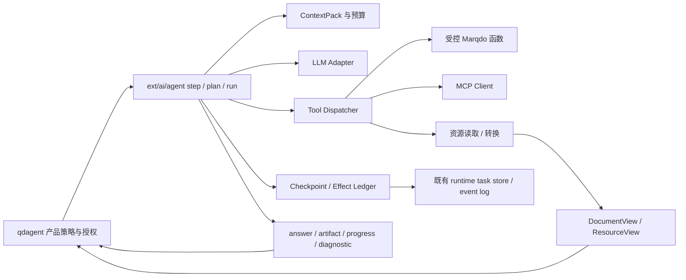

# Marqdo 智能体能力补足：恢复、工具、上下文与资源视图

| 项目 | 约定 |
|---|---|
| 状态 | **Proposed**；本次交付设计，不代表以下新接口已实现 |
| 日期 / 基线 | 2026-10-27（Asia/Shanghai）；Marqdo `16f26d7` / 2.1.4；qdagent `68b757e` |
| 调研与现状 | [官方资料与源码证据 F01–F20](../research/agent-capabilities-2026-10-27.md) |
| 产品配套 | [qdagent 智能体能力与预览设计](../../../qdagent/doc/design/agent-capabilities-and-preview-2026-10-27.md)（同级 checkout） |
| 继承 | [ext/agent](ext-agent.md)、[隔离 Web 运行时](isolated-web-runtime-development-2026-10-26.md)、[工作台合同](qdagent-workbench-runtime-and-view-2026-10-25.md) |

## 1. 目标与架构边界

让同一套文档原生 Agent 在模型错误、工具失败、网络中断后有界恢复；让工具可发现、可验证、可审计；让结果同时服务模型上下文与用户阅读。保留 `.mq.md` 工作簿、EKC 与验证证据的权威地位，不把框架改成第二套产品聊天服务。

现有 `src/runtime/` 已实现隔离进程、任务/事件与控制通道，本设计在其上补 Agent 步骤语义。现有 `ext/ai/agent.mq.md` 已有 step/plan/run、CALL/READ、观察压缩，继续扩展。框架不持有求道“笔记”业务表、中文按钮、默认回答字数或具体供应商账户。

| 议题 | Marqdo 所有 | qdagent 所有 |
|---|---|---|
| 恢复 | 错误分类、预算、检查点、工具效应、运行/事件语义 | 恢复按钮、会话关联、凭证修复入口、产品政策 |
| 工具 | ToolSpec/Call/Result、schema、权限执行、并发、MCP 传输 | 业务工具、默认集合、连接配置、用户授权范围 |
| 回答 | 结果分通道、输出预算、角色消息、finish reason | 简洁/标准/详细策略、摘要与产物卡、ASK/BUILD 行为 |
| 资源 | ResourceRef、只读内容/派生预览、定位、转换插件接口 | 笔记/文件/产物 ID 映射、owner 权限、预览组件和布局 |
| 知识 | preflight/reuse/verify/compile、记忆原语 | 何时提议沉淀、用户画像与可见管理 |
| 调试 | span、结构化事件、用量与错误码 | 可读过程、运行详情、产品评测语料 |



## 2. 现状与增量

| 已有能力 | 本轮不能误判为缺失 | 要补的具体语义 |
|---|---|---|
| runtime.task_control_v2/event_replay/read_lane | 不再新建一套队列与 SSE 框架 | Agent 步骤恢复与传输重放的边界 |
| resume_save/load | 不再新建平行 checkpoint 命名空间 | 原子提交、版本摘要、作用域、效应关联 |
| CALL、ARGS、READ、plan patch | 不废弃文档式编排 | 类型化 schema、校验错误、有限修复、稳定 call_id |
| MCP stdio client | 不从零重写连接器 | timeout/cancel、resource、远程 transport 的能力探测 |
| DocumentViewV1 / Locator | 不另写 `.mq.md` 解析器 | 普通资源类型、明确 renderer、历史与相对资源处理 |
| LLM messages/usage | 不把 provider 行为交给产品猜测 | 输出预算、原生工具适配探测、角色边界与分通道 |

新模块路径及协议名以下均是**建议落点**。首批开发先固化 schema 与 fixture，再开放 feature bit；不得只更新 capabilities 把未实现能力标真。

## 3. 错误和恢复合同

### 3.1 ErrorV1

现有字符串错误保留兼容适配，新工具与 Agent 结果返回：

```json
{
  "schema": "AgentErrorV1",
  "code": "tool.timeout",
  "category": "transient",
  "stage": "tool",
  "message": "读取资源超时",
  "retryable": true,
  "retry_after_ms": 1200,
  "effect_state": "none",
  "recovery_action": "retry_step",
  "call_id": "call_01",
  "details_ref": "resource:diagnostic_01"
}
```

`retryable` 仅是候选信息，最终动作由可信策略结合效应、截止时间、预算、取消状态决定。远端工具声称 readOnly/idempotent 不构成授权依据。凭证和原始堆栈不进入公开 message。

| 错误类别 / 例子 | 框架动作 | 不允许的动作 |
|---|---|---|
| transient：429、部分 5xx、连接失败 | 只在安全步骤重试，遵守 Retry-After | 无限重试、复用同一流片段直接追加 |
| invalid_arguments：schema 不匹配 | 把字段级错误作为 observation，最多 1 次参数修复 | 启动工具后才校验；静默丢弃字段 |
| validation_failed：编译/文档校验 | 保留候选与诊断，局部修复后重新验证 | 将未验证草稿标为成功 |
| context_overflow | 压缩可重建上下文，保留任务/限制/未决效应 | 丢失最新用户指令、授权或版本 |
| auth / forbidden | 直接 needs_input/blocked，交应用处理 | 换身份、扩大范围或匿名绕过 |
| conflict / stale_revision | 重新读取版本并重新规划 | 覆盖用户修改、对写操作盲重试 |
| capability_unavailable | 返回可行替代操作清单 | 假称已搜索、已渲染或已执行 |
| policy_denied | 显式拒绝该动作 | 把限制当工具错误让模型规避 |
| budget_exhausted | 保存状态与已完成结果，返回 partial | 自动增预算或伪造 completed |
| unknown_effect / worker_crash | 对账、查询外部状态，不能判断则 needs_reconciliation | 重跑整个工作簿 |
| cancelled | 停止新调用、保留可读产物、传播取消 | 在后台悄悄修复或恢复 |

初始建议：传输最多 2 次重试（总 3 次尝试），指数退避基准 0.5/1 秒并加 jitter；有 Retry-After 时使用服务端建议并受总 deadline 限制。参数修复最多 1 次，内容修复最多 2 次。预算由应用传入，框架只提供默认上限与执行机制。所有重试、修复和摘要模型调用计入同一成本账本。

错误指纹 `hash(tool_id, normalized_arguments, error_code, relevant_revision)` 连续出现 2 次且没有新证据时中止该策略，允许一次有依据的替代路径；不能通过改写错误文本绕过循环检测。

### 3.2 四类“恢复”必须分开

1. **续订事件**：客户端从 cursor 重放和订阅同一个 task，不发起新推理。
2. **重试步骤**：相同逻辑 operation、同幂等键；新 invocation attempt，复用成功的前序结果。
3. **恢复工作流**：从兼容 checkpoint 建立新 runtime task / attempt，关联 `resumed_from`，不把旧终态改回 running。
4. **重新生成答案**：新的输出版本；已有成功工具结果可复用，用户明确重新执行才重新产生效应。

当前 TaskState 把 interrupted/needs_reconciliation 视为终态，沿用此约定。新增 `AgentRun` 逻辑关联只管理目标和 attempt 链；调度权仍在原 runtime。恢复请求带 `expected_revision`、checkpoint digest 与幂等键，相同请求返回同一新 attempt，冲突返回 409 对应的框架错误。

执行失败不必丢掉有用内容：`outcome.status = succeeded | partial | failed | needs_input | cancelled`，伴随 `answer_ref/artifacts/error/recovery_options`。HTTP 调用成功与 Agent 业务 succeeded 不再混为同一字段。

## 4. 检查点与工具效应

### 4.1 CheckpointV2

在 `plugins/agent/src/resume.rs` 扩展已有实现，统一根目录由宿主提供，客户端不能传任意绝对路径。保留 legacy load，但旧 checkpoint 无效应信息时默认 `manual_review`，不能自动重做写操作。

| 字段组 | 内容 |
|---|---|
| 身份 | schema、checkpoint_id、logical_run_id、task_id、attempt_id、step_id、parent_checkpoint_id |
| 作用域 | principal_ref、workspace_id、session_id、授权 scope digest |
| 输入 | task revision、workbook revision/hash、输入资源 revisions、knowledge generation |
| 运行配置 | ModelSnapshot public ref、tool registry digest、policy revision、runtime compatibility |
| 进度 | completed_steps、pending_operation、observation refs、context summary ref |
| 约束 | 剩余 token/tool/time/cost 预算、deadline、cancel epoch |
| 一致性 | effect ledger watermark、event seq、manifest digest、committed_at |

写入协议：写唯一临时文件→flush/fsync→原子 rename→提交 checkpoint 指针；持久化配置下目录 fsync 按平台支持实现。所有引用 blob 在指针提交前落盘。损坏记录报 `checkpoint.corrupt` 并尝试上一个完整版本，不能读取半个 JSON 当无历史。

恢复前校验身份/授权、源版本、工具 schema 与模型兼容性。权限撤销立即生效；checkpoint 不是永久授权。源文件改变返回 `checkpoint.input_changed`，重新计划受影响步骤，不能偷偷使用最新文件继续旧验证结果。

### 4.2 Effect ledger

```text
prepared → started → committed
                 ↘ failed_no_effect
                 ↘ unknown → reconciled_committed | reconciled_no_effect | needs_input
```

每个 operation 持久记录 `operation_id/idempotency_key/args_digest/resource_scope/expected_revision/effect_class/result_ref`。幂等键作用域是 principal + workspace + logical_run + step + operation，不用随机 attempt ID 替换稳定 operation key。对同 key 不同 payload 拒绝。

读工具可重试；确定幂等写由服务端去重；可补偿写仅在补偿明确安全时执行；未知写先查询 receipt/版本。对外部系统不能承诺通用 exactly-once。关键 crash 窗口是“远端已成功、本地尚未记账”，必须返回 unknown 并对账。

本地文件使用 expected revision + staging + atomic replace；变更提交后检查点失败也靠 operation receipt 恢复。`tool.completed` 必须在结果与 receipt 可读取后提交，再对外发事件。事件发送失败不回滚已发生的业务效应。

不要复制 runtime 事件存储：Agent ledger 与 artifact manifest 是步骤事实，现有 runtime event log 是传输/调度事实；以 ID 关联，采用可重建投影与 outbox。跨 DB/文件不能声称一个事务完成，使用 manifest 提交点和恢复扫描补齐索引。

## 5. 结构化工具与调度

### 5.1 ToolSpecV1

```json
{
  "schema": "ToolSpecV1",
  "id": "workspace.read",
  "version": "1",
  "description": "读取授权资源的指定行范围",
  "input_schema": {
    "type": "object",
    "properties": {
      "resource_id": {"type": "string"},
      "revision": {"type": "string"},
      "start_line": {"type": "integer", "minimum": 1},
      "max_lines": {"type": "integer", "minimum": 1, "maximum": 500}
    },
    "required": ["resource_id"],
    "additionalProperties": false
  },
  "output_schema_ref": "ResourceReadV1",
  "effect": "read",
  "scopes": ["workspace:read"],
  "timeout_ms": 10000,
  "max_result_bytes": 65536,
  "idempotency": "safe",
  "concurrency_group": "resource-read",
  "availability": "ready"
}
```

定义由宿主/可信模块注册；用户认证、scope 与资源根由宿主注入，不接受模型提供 principal 或任意 root。`read`、`write`、`execute`、`external_write` 是策略分类，不是靠工具命名推断。

ToolCallV1：`call_id/tool_id/tool_version/arguments/operation_id/parent_span_id`。ToolResultV1：`ok/status/summary/structured_content/resources/citations/error/usage/truncated/next_cursor/effect_receipt_ref`。超限结果先写 artifact，再返回摘要和范围读取句柄；不把几十 MB 文本送进 prompt。

### 5.2 一条执行通道

```text
发现 → 加载 schema → schema 校验 → 授权与范围解析 → 预算/取消检查
→ 幂等查询 → 执行 → 结果 schema/大小校验 → receipt/结果提交 → 事件 → observation
```

provider 原生 function call 与文档 `CALL:name + ARGS:{...}` 都归一到该通道。保留旧白名单适配，已有 `.mq.md ##` 可根据形参推导初始 schema，再允许显式描述收紧。转换不允许调用未暴露的框架内部函数。禁止对模型参数使用 eval/任意代码反序列化。

`tools.search` 返回已授权且当前可用的工具摘要；`tools.describe` 按 ID 返回完整 schema。核心 5–8 个工具可常驻，其余按需加载；此数量是产品起始配置，不写死框架。每次真正调用仍重新检查授权；搜索索引可列 unavailable 原因供诊断，但不能让未授权工具名字泄露私有连接信息。

初始支持 JSON Schema 的明确子集并公开能力；不支持的 schema 拒绝注册，不静默放宽。原生工具能力、并行工具调用、图片输入、结构化输出分别探测；纯文本兼容 provider 继续走 CALL，但并发和可靠性承诺按测试能力开放。

### 5.3 并发、MCP 与程序化执行

独立只读调用可并发，默认最多 4 个；修改同一资源的调用串行且用 revision CAS。依赖链、审批与取消检查保持顺序。一个并发调用失败不丢弃其他已成功结果。

MCP 扩展现有 client：先完善 timeout/cancel、错误映射、工具分页与 schema、resource read/link，再按 capability 增加远程 Streamable HTTP 与连接认证。stdio 不应允许模型选择任意宿主可执行文件。连接元数据归应用，凭证通过 secret handle 注入 worker，工具输出和 trace 不记录密钥。

工具 annotations 只是提示，可信策略确定真实效应。外部结果全部为数据，不能提升为 standing/system。MCP resource URI 转成宿主授权 ResourceRef，不允许前端直接请求任意 file:// 或内部网地址。

程序化工具编排和子 Agent 为后续切片：在沙箱中仅暴露注册 dispatcher，逐次执行同样的授权、预算和效应日志；禁止通过一段脚本绕过逐工具控制。子任务继承更小权限和共享总预算，不默认开放写同一资源。

## 6. 输出通道与上下文

### 6.1 AgentOutputV1

```json
{
  "schema": "AgentOutputV1",
  "status": "succeeded",
  "answer": {"format": "markdown", "text": "已整理为三点，完整笔记见右侧。"},
  "artifacts": [{"resource_id": "res_note_01", "revision": "sha256:example"}],
  "citations": [],
  "validation": {"status": "passed", "report_ref": "resource:verify_01"},
  "finish_reason": "completed",
  "recovery_options": []
}
```

这是结果传输协议，不要求模型每次逐字生成这张 JSON。文档式编排仍可产出 `.mq.md`，框架把稳定产物、摘要与事件归一化。普通文本回答可没有 artifact 和 validation；未运行的内容标 `not_applicable/not_run`，不能填 passed。

channel 至少区分 `answer/artifact/progress/diagnostic`。只有 answer delta 可追加到聊天正文；工作簿 token 和工具日志进入其他通道。进度是可观察动作摘要，不要求或泄露模型内部思维链。

应用传 `ResponsePolicy`：detail level、目标长度、最大输出 tokens、是否允许 artifact、用户显式需求。框架负责 budget 和 finish_reason，中文字符数与最终文案由应用决定。达到 token 上限返回 `length_limited` 和完整/不完整标记，不能裁剪 JSON/代码后假装成功。

优先从已验证产物结构投影摘要。必要时增加一次受预算控制的摘要模型调用；摘要不得新增未经证据支持的结论。修复成功后 accepted candidate、结果正文、artifact revision 与 verification digest 必须全部一致。

### 6.2 ContextPackV2

按优先级组装：可信运行规则→最新用户目标/约束→用户选中资源范围→未决操作/成功步骤摘要→检索证据→近期对话→可回读历史。保持角色结构，不把用户/工具文本简单拼进系统指令。

每个 item 携带 `origin/trust/resource_ref/revision/token_estimate/priority`。预算初值建议保留模型窗口 20% 给输出与协议开销；上下文使用达到可用预算 70% 时触发整理，具体比例配置化。优先剔除可重读的完整工具输出，保留摘要、引用和失败恢复锚点。

Compaction 必须保留：目标、用户限制、当前计划、已完成步骤、待决写入、授权范围、输入版本、已接受产物与引用、余量。summary 绑定其 source event range 和 digest，不能当成新的已验证知识。工具输入过时须重读，不能依赖压缩摘要执行写入。

已有 EKC/agent memory 继续提供知识发现和复用。长期用户记忆的创建/修改/删除政策归 qdagent；网页中的指令不能自动变成长期偏好。

## 7. 统一资源与只读视图

### 7.1 ResourceRefV1 / ResourceViewV1

ResourceRef 统一携带 `resource_id/workspace_id/kind/media_type/revision/digest/title/size/origin/locator`；opaque ID 由宿主映射，不将浏览器 path 直接当文件权限。revision 是内容版本，generation 是知识发布代，两者不混用。

```json
{
  "schema": "ResourceViewV1",
  "resource": {
    "resource_id": "res_01", "workspace_id": "ws_01", "kind": "file",
    "revision": "sha256:example", "media_type": "text/markdown", "title": "设计说明"
  },
  "renderer": {"id": "markdown", "version": "1", "trust": "sanitized"},
  "render": {"format": "sanitized_html", "fragment": "<p>正文</p>"},
  "outline": [],
  "locators": [],
  "completeness": "complete",
  "no_exec": true,
  "diagnostics": [],
  "next_cursor": null
}
```

继续把 `.mq.md` 交 `view.document`，ResourceView 只包装/扩展，不能另解释一套 Marqdo 语义。普通 `.md/.txt/代码/JSON/CSV` 走媒体类型处理，避免全仓语义编译。浏览器组件由 qdagent 实现，框架只提供可读内容、受控片段或短期授权 blob 引用。

`fragment`、`text`、`blob_ref` 是互斥载荷，按严格 format enum 解码。未知格式返回 unsupported，不能用 `format.includes('html')` 猜测 HTML。为空与加载失败必须有独立状态。

### 7.2 格式矩阵

| 格式 | 框架提供 | 前端消费 | 未具备能力时 |
|---|---|---|---|
| `.mq.md` | 静态 DocumentView、outline、节点/引用 | 正文、语义链接、源码切换 | 只读源码 + 明确诊断，不执行 |
| Markdown / 笔记正文 | 共享静态 Markdown→受控结构/HTML、相对资源引用 | 标题、列表、表格、代码、链接 | 纯文本 |
| 文本/代码 | 分页行片段、编码信息、行定位 | 行号与语法高亮 | 编码提示/下载 |
| JSON / CSV | 有界解析、路径/行列定位、分页 | 树/表/源码 | 原始文本，标格式错误 |
| 图片 | 授权 blob、尺寸/元信息 | 缩放/旋转/替代文本 | 下载，不暗示已做 OCR |
| PDF | blob、页元信息，可选提取插件 | PDF.js 页渲染与定位 | 文件卡；提取不可用不阻止支持的视觉预览 |
| DOCX/XLSX/PPTX | 受限转换插件，可选 PDF/HTML 派生物 | 按派生格式预览 | 未安装转换器，保留下载 |
| HTML/SVG | 默认源码；允许时经严格清洗或受限派生物 | 隔离预览 | 不以内联可执行页面显示 |
| 未知二进制/压缩包 | 元数据 | 下载卡 | 不自动解压/执行 |

提取、预览、执行各有独立 capability。办公转换、OCR 使用受限 worker，禁宏与网络、限制时间/内存/页数/解压膨胀比；结果绑定原件 digest、转换器版本和参数。首期不承诺保真编辑。

### 7.3 安全、定位、缓存

所有读取先校验宿主授予的 workspace/resource scope，canonicalize 并处理 symlink 逃逸；读取句柄与校验对象一致，防路径检查后替换。读取原件的身份权限不可被缓存绕过。

预览绝不调用 `run/verify` 或有执行副作用的 view 路径；正文中的 Marqdo 调用链接只展示语义与导航，执行需单独工具调用与授权。远程图片、相对链接、资源 URL 经受控解析；下载入口不允许任意内网 fetch。

HTML 清洗在框架产出侧和浏览器插入侧都有明确边界；用成熟 allowlist 实现而非正则。禁止 script/event handler、危险 URI、任意 style/form/嵌入对象。前端配 CSP；对需要交互的产物另建无权限 sandbox，不复用文档渲染器。

缓存 key：workspace + resource ID + revision + renderer version + render options + policy version；命中前重新授权。历史 revision 不存在就返回 `version_unavailable`，不能默默展示当前版。locator 支持 node/span/line/page/cell，失效时标 stale 并提供用户主动查看最新版的操作。

建议首期限制：文本片段 256 KiB、代码单次 500 行、CSV 单次 200 行；更大内容分页，完整文件保留。数值需压测校准，不作为现有系统性能声明。

## 8. 事件、可观测性与能力协商

复用 RuntimeEventV2 的 task/run/attempt/seq/event_id。拟增加事件类型：`agent.step.started/completed`、`tool.started/completed/failed`、`recovery.scheduled/exhausted`、`checkpoint.committed`、`artifact.updated`、`answer.delta/committed`、`context.compacted`。现有 `message.delta` 由兼容适配映射 answer channel，不能同时重复消费两套事件。

终态提交包含 accepted output manifest、last_seq、result digest；断流客户端能通过快照补齐最终答案。stream delta 是预览，最终 committed revision 是权威。统计每次尝试的 usage，摘要和修复调用分别标 purpose；未知计量保持 unknown。

拟新增 capability：`agent.error_v1`、`agent.checkpoint_v2`、`agent.tool_schema_v1`、`agent.output_channels_v1`、`agent.context_pack_v2`、`resource.view_v1`，以及各 media renderer 的独立版本/可用状态。保持现有 probe，新增字段向后兼容；未知 feature 当不可用。

trace 记录因果 ID、耗时、错误类别、参数摘要、资源版本和 effect receipt。正文与密钥按配置脱敏，不默认把用户全文件复制进日志。输出中不包含模型私有推理；可审计的是实际动作与结果。

## 9. 分阶段实现与文件落点

| 包 | 修改/新增建议 | 交付内容 | 依赖 / 退出条件 |
|---|---|---|---|
| M-A0 | `src/workbench/capabilities.rs`、`tests/workbench_contracts.rs`、新增合同 fixtures | 上述协议、旧适配、状态映射 | 先冻结跨仓字段，未知字段/版本可降级 |
| M-A1 | `ext/ai/agent.mq.md`、`plugins/agent/src/resume.rs`、新 recovery/effects 支撑模块 | 分类错误、有界修复、accepted candidate、原子检查点 | M-A0；故障注入不重复写、旧记录不冒险自动恢复 |
| M-A2 | `plugins/agent/src/lib.rs`、`mcp_client.rs`、新 tool registry/dispatcher | schema 工具、调用统一、分页与结果资源 | M-A0；未授权调用为 0，失败结果结构正确 |
| M-A3 | `src/workbench/document_view.rs`、新 resource_view、媒体适配模块 | ResourceRef/View、普通格式静态阅读、no-exec | M-A0；资源定位与安全语料通过 |
| M-A4 | `ext/ai/agent.mq.md`、`plugins/llm/src/lib.rs`、`src/workbench/run_context.rs` | 输出分通道、预算、ContextPackV2 | M-A1/2；原生和纯文本 provider fixture 都可用 |
| M-A5 | `src/runtime/` 的既有存储/事件适配、MCP 与转换插件 | 恢复对账、PDF/Office 插件、远程 MCP | M-A1/2/3；持久模式 crash/restart 通过 |
| M-A6 | plan/subtask/sandbox 扩展 | 程序化工具、有界委派与可选浏览器 | 后置；须证明任务收益和预算/效应可控 |

先交 M-A0 与 qdagent P0 的静态阅读/错误结果修复；不要让完整 checkpoint v2 阻塞笔记预览。M-A1 可先上只读重试，写恢复待 ledger 通过再开放。新特性默认关闭直到对应合同实测通过，旧路径继续可读。

## 10. 验收与评测

所有目标是 proposed gate，尚未实测。基础机制用确定性 fake provider/tool；真实 provider 做少量单独 smoke 并记录费用，不能把随机模型输出作为唯一门禁。

| 编号 | 故障/任务 | 必须观察到的结果 |
|---|---|---|
| MA-T01 | 第一次 429、第二次成功 | 尊重退避、计量 2 次、最终只有一个 accepted answer |
| MA-T02 | 连续 schema 参数错误 | 一次修复后停止；工具未在无效参数下执行 |
| MA-T03 | 工具写成功但 receipt 提交前杀 worker | unknown_effect→查询对账；写计数不增加 |
| MA-T04 | checkpoint 写一半杀进程 | 读取上个完整 checkpoint 或明确 corrupt，不产生伪成功 |
| MA-T05 | 终态事件丢失、cursor 重放 | 最终快照恢复完整消息，工具执行次数不增加 |
| MA-T06 | 恢复请求重复/并发 | 同一幂等键只产生一个恢复 attempt |
| MA-T07 | 用户取消与重试定时器竞争 | 取消生效后无新工具调用，旧任务不复活 |
| MA-T08 | 执行中资源/权限改变 | stale/conflict/forbidden，不覆盖新版本 |
| MA-T09 | 恶意文本伪造 CALL/system | 不跨越工具白名单和授权范围 |
| MA-T10 | `.mq.md` 预览含写文件/联网语句 | 哨兵文件/网络计数不变；只读渲染成功或安全降级 |
| MA-T11 | 资源格式、超长输出、路径逃逸 | 正确 renderer/分页；越界拒绝；无 HTML 注入 |
| MA-T12 | 修复原文 A 得到通过验证的 B | answer/artifact/verification 都绑定 B digest |
| MA-T13 | 上下文压缩后继续 | 最新约束、待决效应、资源版本与剩余预算不丢失 |
| MA-T14 | 旧 CALL、旧 DocumentView 消费端 | 基础行为可用，能力缺失有明确返回 |

先运行受影响的 Rust/Go/Marqdo 合同与既有隔离 runtime 金样例，再做跨仓 HTTP/browser gate。性能目标：已缓存 100 KiB 文本视图服务端 p95 < 300 ms、核心工具发现 p95 < 100 ms，基准机器/并发/冷暖缓存必须记录；第三方网络延迟单独列出。

## 11. 迁移、回滚与未决项

兼容迁移按“新增协议→双读→新写→验证→逐步移除旧适配”推进。`.mq.md` 源码与旧运行产物不批量重写；旧 resume JSON 可读取但不能自动升级成带副作用保证的检查点。v2 checkpoint/ledger 保留 schema 版本，新老版本不并发写同一运行。

回滚关闭新工具自动发现、输出通道或转换器时，已提交资源和最终答案仍可读；执行恢复中的任务先 drain/停止接纳，不能切回会盲重做写操作的旧路径。迁移前备份可变索引与 manifest，回滚不删除用户产物。

实现前验证项：现有 runtime 持久存储可提供的原子提交边界、各平台 fsync/rename 行为、LLM adapter 原生 tool call 流式兼容、转换插件部署体积。协议优先按本文保守语义实现，验证不能满足则 feature 保持不可用，不阻塞已经完成的只读预览切片。
