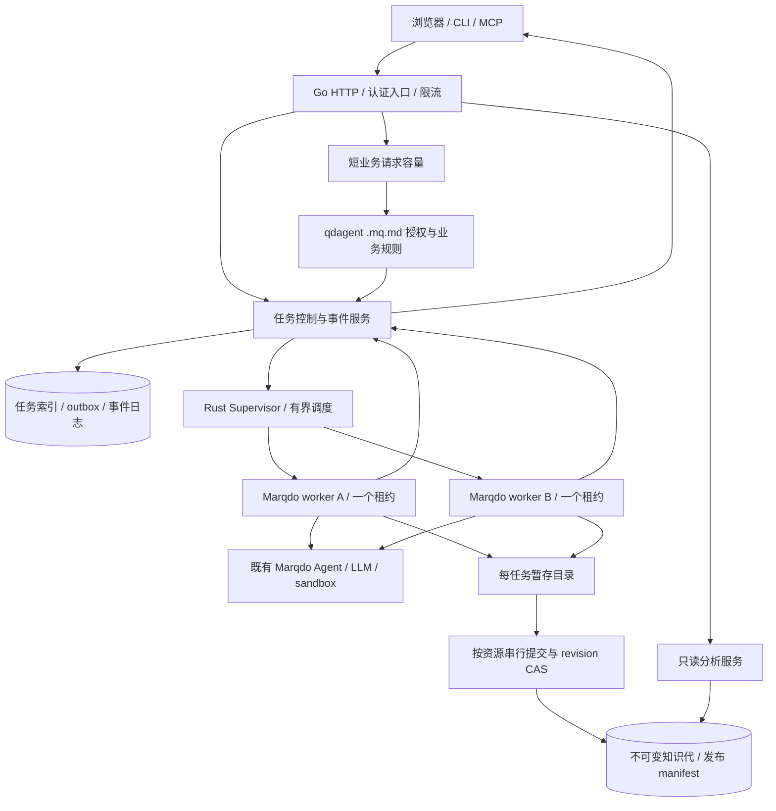

# 隔离执行与响应式 Web 运行时：详细开发设计

| 项目 | 约定 |
|---|---|
| 状态 | **Verified**（execute 路径）；HTTP `execute` / `sse-live` / `stream:true` 默认走 Supervisor worker 池（不再经父进程 `CallLibPath` / `INVOKE_LOCK`）；`runtime.isolated_execution=1`；MR-01 金样例 `tests/isolated_execute_mr01.rs`；未声明非流式仍 `legacy_serial`（ADR 0008） |
| 基线 | Marqdo `1b11fe0` / 2.1.3；qdagent `64b97e5`；2026-10-26 |
| 问题依据 | [单解释器缺陷](web-invoke-serialization.md)、[ADR 0008](../adr/0008-web-invoke-serialization.md)、[本轮跨库复核 R01–R14](../../../qdagent/doc/gaps/04-workbench-runtime-and-product-audit-2026-10-26.md) |
| 产品配套 | [qdagent 可靠工作台开发设计](../../../qdagent/doc/design/reliable-workbench-development-2026-10-26.md) |
| 继承合同 | [工作台 M00–M06](qdagent-workbench-runtime-and-view-2026-10-25.md) 中 ModelSelection、ModelSnapshot、Usage、DocumentView、Locator；保留文档原生作者面 |

## 1. 目标、边界与不变量

目标是让用户在长对话、导入和构建过程中持续打开模型列表、读取来源、修改下一轮设置并可靠停止任务。高并发容量按资源预算显式限制；不能让所有请求进入一把解释器锁再超时。

Marqdo 负责通用执行隔离、资源调度、事件/取消、语义分析和制品校验。qdagent 负责用户/工作区授权、业务状态与发布政策。产品仍通过 `.mq.md` 调用 Marqdo Agent，不增加第二套模型循环或知识编译器。

必须保持的系统不变量：

1. 同一个可变 HostContext 同时最多一个求值者；不删除锁、不增加虚假的 `unsafe impl Sync` 来获得并行。
2. 一个执行租约只属于一个 run/attempt；凭证、事件、取消、cwd、权限和模型选择不可流入另一请求。
3. 控制与读取具有独立容量，不被 LLM 等待占满；停止不需要重新进入正在执行的解释器。
4. 事件可以重投，外部副作用不默认重做；不宣称跨网络 exactly-once。
5. 已确认终态不能被晚到完成/取消覆盖；取消不回滚已经完成的外部写入。
6. 阅读不执行 `.mq.md`，缓存不绕过授权或版本校验；缓存命中必须实际复用结果。
7. 正文、依赖、证据和编译代属于同一不可变快照；不会把两个代的结果拼成一次阅读或执行。
8. 任何能力开关都以实际探测和测试为依据；新 API/schema 在落地前都属于本文提案。

## 2. 架构选择

| 方案 | 优点 | 当前代价 | 本轮选择 |
|---|---|---|---|
| 继续全局锁，只增加 Go handler | 改动小 | 长任务依然阻塞所有 Endpoint，串扰变量也未消失 | 只保留作兼容模式 |
| 同进程多 HostContext | 潜在内存复用较好 | GLOBAL_HOST、插件回调、环境、cwd、事件 sink 生命周期需系统重做 | 后续优化，不是首个交付门槛 |
| 独立 Marqdo worker 进程 + 控制/读取通道 | 隔离现有全局状态，可强制回收卡死任务，复用现有语言与 Agent | IPC、进程启动、内存、发布写协调 | **首选实现** |
| 引入外部通用队列和新业务 Runtime | 容易扩到集群 | 运维复杂度及第二套编排风险 | 单机阶段不引入 |

首期采用**预热的一次性执行进程池**：进程可预装运行时和非用户特定模块，分配任务后独占，结束即退出并异步补充。这样不用假设清空部分字段就能安全复用 HostContext。长寿命多租约 worker 只有通过状态泄漏、插件资源与 RSS 回归后才开启。只读分析服务可以长寿命运行，但不得加载有副作用的求值插件。



“短业务请求容量”依旧可执行产品 `.mq.md`，但有独立 worker 预算和短 deadline。控制服务只做通用接纳、状态 CAS、取消与日志投递，不把模型选型、知识晋升等业务逻辑搬进 Go。读取服务接收经过授权的资源句柄；不得直接相信浏览器提交的绝对路径。

## 3. 路由分类与接纳

### 3.1 执行类别

在 Endpoint 装配中新增可选 metadata（字段名待 schema 固定）：

| 类别 | 示例 | 资源预算与规则 |
|---|---|---|
| `control` | 任务查询、事件订阅、取消、health | 不执行用户代码；认证后访问任务存储/租约注册表 |
| `read` | view.document、引用解析、已发布模型列表投影 | 只读快照；不写用户源码；可缓存 |
| `short` | 保存设置、创建导入、接纳任务 | 无 LLM 长等待；默认 deadline 2s，较慢动作转为任务 |
| `execute` | ASK/BUILD/生成/验证 | 有界队列、专属进程、显式任务 deadline |
| `commit` | 切换知识代、合并受控文件变更 | 按 workspace/kb 的短临界区；执行前检查 revision |

旧 Endpoint 未声明时仍走 legacy_serial；不能自动猜测任意函数是纯读。纯度来自静态能力和注册配置，实际写权限仍由宿主限制。文件上传字节传输不占解释器，应先落隔离存储，再进入短接纳路径。

### 3.2 接纳步骤

1. HTTP 层解析受限请求，验证身份、格式、速率与连接数量。
2. 产品短入口解析 workspace/model/policy；授权版本与模型配置 revision 一并冻结。返回规范化任务请求，不执行 Agent。
3. 控制服务在同一数据库事务中登记作用域化 idempotency key、payload hash、task 和 dispatch outbox；重复请求读回已有 task，同键异内容返回 409。
4. 提交事务后才返回 202/Location。调度器消费 outbox 分配租约，租约带 attempt/epoch。
5. 对同步兼容 API，先完成接纳，再挂接结果；等待客户端超时不等于安全重做。

队列入库前容量不足返回 429 + Retry-After；服务不可用返回 503；接纳失败不发送 started。控制通道须保留槽位，不能因为数据流连接占满而无法取消。

## 4. Supervisor、生命周期与调度

### 4.1 Worker 生命周期

`starting → ready → leased → running → draining → exited`；启动失败/心跳丢失走 `unhealthy → terminating → exited`。任务状态由控制服务维护，进程状态不能直接当作业务成功。

- worker 启动握手报告 CLI/ext/native、protocol_version、能力、构建摘要；不匹配不进入 ready。
- 预热阶段不读取用户凭证、不挂载工作区写权限。分配租约后挂载当前任务的 capability roots、只读快照和独立 staging。
- 每任务具有随机 lease_id、run_id、attempt_id、epoch、绝对 deadline 和资源限制。
- Supervisor 持有进程句柄、子进程组、事件通道与取消句柄。worker 不能自行修改其他 worker 状态。
- 返回业务结果后仍须 drain 事件/用量并提交最终 checkpoint，控制服务持久化终态后确认 ACK，之后释放租约。
- 超时或断连清理不能遗留孤儿子任务；正常优雅退出后再删除临时文件。异常由独立 janitor 按租约过期回收。

### 4.2 有界、公平与资源预算

初始验证配置建议 4 vCPU/8 GiB、执行槽 2、短请求槽 1、读取服务 1。具体容量由每类任务的 RSS p95 和 CPU profile 决定，不能把这个数当所有机器的默认。执行槽上限：

`min(CPU约束, floor((可用内存 - 系统/控制/缓存预留) / worker_RSS_p95))`。

运行队列按 workspace 轮转，再按 session FIFO；一个 session 默认只允许一个活动 turn，跨 session 可并行。相同知识库的生成可并行，发布只占短提交锁。interactive 优先于后台索引，但后台使用老化提升或最低服务配额，防永久饥饿。

全局队列初始上限 64、单工作区 16、单会话待处理 4，均可配置；队列超限及时返回，不能悄悄丢任务。显示队列位置或“前方有任务”，没有可靠完成时间估计时不显示虚构倒计时。

### 4.3 副作用与重试

任务声明 `read_only / staged_write / external_effect`，由工具权限校验而非模型自报。read_only 可按政策重试；staged_write 丢弃未提交 staging 后重试；external_effect 出现超时/失联时标记 `effect_unknown`，等待核对，不自动重复支付、发信或写入。

稳定的操作键使用 `task_id + logical_step_id`，attempt_id 只标记传输尝试，不应导致同一外部动作生成新的去重键。工具不支持幂等查询时，只能明确报告不确定。工作簿记录已完成与未知副作用；“已停止”不意味着“全部撤销”。

## 5. IPC 与请求上下文

首期使用本机 Unix socket 或匿名管道，采用长度前缀 JSON 控制帧与独立事件通道。协议禁止无上限 JSON/单行日志；控制帧初始上限 1 MiB，大文档通过授权 blob handle 传递。普通 stdout/stderr 仅诊断，不与协议混流。当前 NDJSON 文件桥保留为 legacy fallback。

新增 `InvokeRequestV2` 示例（提案）：

```json
{
  "schema": "InvokeRequestV2",
  "schema_version": 2,
  "task_id": "task_01",
  "run_id": "run_01",
  "attempt_id": "attempt_01",
  "lease": {"id": "lease_01", "epoch": 3},
  "entry": {"module": "agent/qdagent.mq.md", "function": "run"},
  "args_ref": "blob:sha256:...",
  "context": {
    "workspace_id": "ws_01",
    "snapshot_id": "generation_01",
    "selection_ref": "model-snapshot_01",
    "capabilities_ref": "grant_01",
    "deadline_at": "2026-10-26T08:10:00Z"
  }
}
```

`grant_01` 是服务端验证的短寿命授权句柄，内容包括 principal、scope、根目录、允许效应、授权 revision、失效时间。worker 不使用浏览器任意传入的 fn/path。权限撤回后，新的工具调用必须重新验证 lease/grant，已开始的外部调用记录撤回时间与实际结果。

`RunContextV1` 保留原有字段与序列化兼容，内部增补显式 Context 对象；扩展 V2 由能力协商启用。event_sink、usage_sink、cancel_token 使用句柄，不使用外部可控路径。子任务通过 IPC/Command.env 显式继承，禁止父进程 `setenv`/`set_current_dir` 承担请求状态。

凭证在租约启动时通过受保护 IPC 或继承 FD 注入；不落任务 JSON、argv、日志或通用事件。模型快照可含 credential_ref，不含 api_key。即使选择相同 provider，不同请求的授权也不得合并。

## 6. 取消协议与状态 CAS

任务基础状态：`accepted → queued → running → finalizing → succeeded/failed`；queued/running 可进入 `cancel_requested → cancelled`；worker 失联进入 `interrupted`，副作用不明时进入 `needs_reconciliation`。这些是提案，产品可以将 succeeded 映射为 completed。

取消顺序：

1. 验证调用者对 task 的权限，CAS 写 cancel_requested、revision 与 requested_at；终态返回原状态，未知 ID 返回 404。
2. 向匹配 lease/epoch 的控制通道发送 Cancel；不经任务解释器锁。queued 任务原子移出待派发队列。
3. worker 在每次 LLM/工具调用、重试、子任务启动和提交之前检查 token；网络请求使用可中断句柄，不能仅在一行输出结束后才检查。
4. 收到 ACK 仍不等于任务停止。等待 worker 报 stopped、落未完成副作用和用量，再 CAS 到 cancelled。
5. 默认 2s 协作宽限、额外 3s 进程退出宽限，之后回收进程组。强制退出记 interrupted/needs_reconciliation，不能伪造干净 cancelled。

完成与取消竞争的线性化点是控制存储的 CAS：终态先提交则 cancel 返回 already_terminal；取消先提交则晚到 result 只可作为证据追加，不能重新变 succeeded。若外部动作已发生但响应晚到，记录 effect outcome，不撤销取消事实。

兼容文件 token 统一：不存在/空/`0` 为未取消，`1`/`cancelled` 为取消；读取失败返回诊断并按明确策略处理。删除 token 只能发生在持有者退出之后。移除全局 `MARQDO_CANCEL` 对多个任务的隐式作用域。

## 7. 事件、SSE 与背压

### 7.1 事件权威

生产者发出 `(run_id, attempt_id, local_seq)`，控制服务去重、持久化并分配 task 内单调 seq/event_id；客户端游标来自持久化日志，不是 handler 重连后从 1 开始计数。终态事件唯一，usage 可以在终态后以更高 usage revision 补录，但不能再次结束任务。

```json
{
  "schema": "RuntimeEventV2",
  "schema_version": 2,
  "event_id": "task_01:42",
  "seq": 42,
  "task_id": "task_01",
  "run_id": "run_01",
  "attempt_id": "attempt_01",
  "type": "message.delta",
  "payload": {"message_id": "msg_01", "offset": 24, "text": "结果"}
}
```

不要直接破坏 RuntimeEventV1；新增字段/新版本由能力协商确定。普通用户可见 progress 只描述工具、阶段、文件等结构化事实；模型内部 reasoning 不作为完成证据，也不默认写入公开事件。

### 7.2 App SSE

新增任务 API 的事件订阅用 `GET /tasks/{id}/events`（最终产品前缀见配套设计），发送 SSE `id`/`event`/`data`；每个 data 是一个完整 JSON。客户端支持 Last-Event-ID、CRLF、多行 data、任意 UTF-8 分块和 EOF 未完成帧。重复事件按 ID 去重；message offset 检查缺口，缺口时恢复快照。

心跳 15s，客户端空闲探测建议 45s；二者可配置。事件保留建议 24h，最终结果/审计按项目政策更长保留。游标早于保留边界返回 410 `event.cursor_expired` 和快照入口，不能默默从最新开始丢字。

订阅断开默认只关闭订阅。App 显式停止通过 cancel API，切页/移动网络重连可恢复同一任务。传统同步 OpenAI 调用可保持 disconnect=cancel 的兼容策略，但必须显式区分，不能统一把所有浏览器断流当取消。

### 7.3 OpenAI 兼容流

`/v1/chat/completions stream=true` 输出 OpenAI chunk 与 `[DONE]`；App 运行事件由独立入口或协商的协议提供。禁止仅凭任意 JSON body 中 stream=true 将不相关路由自动改为 RuntimeEvent 协议。已发 header 后的错误使用该协议允许的错误帧；发 header 前可用 429/503/401 等正确状态码。

token delta 与最终完整答复分开：最终事件持有结果引用/摘要和 finish reason，不再次追加整篇正文。无 token 能力的适配器报告 `evented_batch`，界面用阶段状态，不把整包人为拆字伪装成实时。

### 7.4 背压和旧桥修复

worker→事件服务与服务→订阅者均有界。建议每订阅者 256 KiB 待发送内存，超出后断开慢消费者并允许按游标重连；事件正文已持久化所以不能静默丢 token。允许合并短时间 delta，必须保留 message offset；usage/终态/错误不丢弃。磁盘压力时停止接纳新任务，已有任务使用保留终态空间并按策略中断，不能无限写事件。

legacy NDJSON tailer 只消费换行已完整到达的字节；保留残片，offset 按真实消费字节移动。超长行、I/O error、文件旋转显式报协议错误。测试至少分三次写一个 JSON、中文多字节边界、恰好 EOF、超过上限、取消与尾帧竞争。禁止吞掉 Scanner.Err() 继续宣告成功。

## 8. 只读快照与真正有效的缓存

### 8.1 快照一致性

分析服务构建 SnapshotKey：规范化 project identity、允许扫描范围、源文件闭包摘要、依赖/来源/配置摘要、compiler/lib/ext 版本、policy/schema、解析选项。输入由编译器枚举，不另造“前 200 个根目录文件”规则。

读取一次快照内的正文、语义和来源，完成后复核输入 manifest；文件在分析中发生变化则重试一次或返回 `snapshot.changed`。对不可变发布代直接读其 manifest。mtime/size 只用于快速发现候选变更，不能代替内容摘要；watcher 丢事件后以完整扫描修复。

### 8.2 缓存结构

- `AnalysisCache<SnapshotKey, Arc<Compilation>>`：实际编译结果。
- `DocumentCache<(SnapshotKey, document_digest, renderer_version, view_options), DocumentView>`：安全 fragment、outline、nodes。
- 同 key single-flight 的 follower 等待同一个 Result，不再次 compile。
- RAII guard 在 error/panic/cancel 时清除 inflight 并唤醒 waiters；等待者有自己的 deadline。
- compile 失败只返回给当前等待者，短暂错误缓存需显式 TTL；不得调用“finish_success”标记失败结果可复用。
- LRU 按字节而非条数上限管理；初始预算按部署内存的 10% 且设硬上限，长文档超限不缓存或分页；记录淘汰原因。
- 每次读取先授权再查缓存；权限敏感的响应按 scope/policy 分区。全局缓存只共享不含用户秘密且访问已验证的不可变语义数据。

性能证据必须统计 `compile_invocations`、输入字节、缓存结果命中、leader/follower、wait_ms、evictions；现有 hit counter 不能证明减少编译。

### 8.3 HTML 与来源定位

沿用 DocumentViewV1，明确 `render.format=plain_text|sanitized_html`。HTML 通过解析器白名单清洗标签/属性/URL scheme，剥离脚本、事件属性、危险 CSS/嵌入与可执行 SVG；相对资源经受限资源端点解析。纯文本始终转义，不以 `<` 字符判断类型。

node_id、revision、generation 必须从定位到读取到浏览器滚动完整传递。不存在历史快照返回 version_unavailable；返回当前版是用户显式操作且标明版本变化。no_exec 测试分别验证“无语言副作用”和“浏览器无脚本执行”，二者不能互相替代。

### 8.4 首次编译的性能改造

本轮 `v3_corpus_1000_compile_smoke` 在 debug 下 243.012s，超过既有 180s 门禁；缓存不能缩短一个全新项目的第一次编译。先为 `knowledge::compile` 的语义编译、语义落盘、检索 extract、检索落盘、manifest 分别加 span，再细分 `ProjectIndex::build`、源枚举/解析、导入挂接、绑定、效应传播、闭包摘要。记录文件数/总字节、节点/边数、parse 次数与序列化字节量。

源码中 `sema::compile_project` 在每个文件查找 module path、每个 module 过滤全量 symbols，属于值得测量的重复扫描；未取得 profile 前不将其认定为 243s 的唯一根因。优化候选按证据选择：建立 path→module 与 module→symbols 索引；同一输入快照共享 parsed module；绑定/依赖图用稳定索引；效应传播用 worklist；闭包按 SCC DAG 计算并保留循环依赖语义；减少每制品重复序列化和小文件写入。

任何优化须保持排序确定性、SymbolId/ArtifactId 与证据摘要规则，禁止通过跳过来源校验、删掉复杂 fixture 或改大超时过关。用 100/1000/10000 单元、无依赖/链/菱形/循环四种图分别测时间与 RSS；给出随 V/E 增长的曲线。release 和 debug 分开；已有 debug 门禁恢复通过只是第一步，§12 的 release 预算仍须独立验收。

## 9. 写入、发布与数据库边界

执行 worker 只写任务 staging；需要写工程时通过沙箱产生文件 diff。发布以 kb 资源锁 + expected_generation CAS 提交。锁只覆盖校验当前版本和切换 manifest，不覆盖 LLM、全文编译或网络调用。

完整发布代先写临时目录、校验摘要、完成必要 fsync，再原子 rename 到不可变 generation 目录；最后在同一文件系统原子替换 CURRENT。源码、编译投影和证据在该 manifest 下对齐。SQLite 中的产品“published”是投影，不参与虚构的文件/数据库跨系统原子事务。通过 publish journal + outbox 恢复：CURRENT 已切换但 DB 未更新时重放；未切换时旧代继续有效。

project_id 与逻辑文档 ID 不随 staging/generation 的物理目录名变化。manifest 保存稳定 project identity、逻辑相对路径和实际 blob/generation 映射；导入引用按项目规则解析，不能因复制到发布目录而重新生成全部符号身份。框架若尚不能区分逻辑身份与物理根，先补该能力，再启用 generation 目录发布；迁移 fixture 必须断言未修改的知识 ID 和跨文档绑定保持稳定。

任务表/幂等/CAS/outbox 需要通用事务能力：先审计 `ext/data` 是否支持事务、条件更新、受影响行数、复合唯一键；缺少则在 Marqdo 数据层补齐，不能用 `.mq.md` 的先读后写模拟原子性。SQLite 使用短事务和有界 busy timeout；WAL/连接池是否开启需按现有插件适配测试确认。单主本地盘为首期部署范围，跨主机共享 SQLite/NFS 不在首期承诺内。

## 10. 临时缓解与迁移

### 10.1 进程池完成前

- 保留 1500ms busy 预算和 Retry-After；展示繁忙，而非无限 spinner。
- 在接纳任何 SSE 之前取得覆盖整个 bridge 生命周期的 legacy 单飞许可，第二条流在修改环境变量/发送 200 前失败；普通请求不得绕过许可观察被污染的状态。
- 断连只标记该任务取消，清理由监督者等待执行结束后负责；无法确认停止时报告 stopping/interrupted。
- 上述步骤只降低 R02/R03 风险，仍不算并行 Endpoint。

### 10.2 功能开关（新增提案）

`runtime.isolated_execution`、`runtime.task_control_v2`、`runtime.event_replay`、`view.analysis_cache_v2`、`runtime.read_lane`。探测返回 feature version 和限制。二进制版本相同不等于所有 native 插件都有该能力。

先离线 fixture → 本地假模型 → 新 workspace → 只读 ASK → staging BUILD → 真正发布。禁止对有副作用的请求做双执行 shadow；允许 shadow 只读分析并比较摘要。

回滚先停接新任务、drain 已接纳任务、保留任务/事件和新 schema；不能将活动任务交给不认识 lease 的旧进程。只读当前发布代可以保留，写入能力按版本协商关闭。ADR 0008 仅在并行金样例与回滚演练通过后由新 ADR 正式替代。

## 11. 开发包与依赖

下列新模块路径是建议，不代表文件已存在。

| 包 | 建议落点与改动 | 前置 | 验收 |
|---|---|---|---|
| M-R0 基线/缓解 | `host/plugin.rs`、`httpx/routes_invoke.go`；固定并发屏障、旧桥许可、取消清理 | 无 | 双流 busy 不改写 A 的桥；断连无提前清理 |
| M-R1 请求上下文 | `workbench/run_context.rs`、`host/subtask.rs`、LLM 插件；统一 token 与显式 sink | M-R0 | 父子运行模型/事件/取消不串；空 token 不取消 |
| M-R2 Worker/IPC | 新 `runtime/{supervisor,worker,protocol,lease}.rs`；独立进程与握手 | M-R1 | 两任务并行、超时回收、子进程无孤儿 |
| M-R3 接纳/控制 | 新 `runtime/{task_store,scheduler,control}.rs` 与 ext/data 事务 primitives | M-R2 | 原子幂等、队列公平、取消与结果 CAS |
| M-R4 事件协议 | `workbench/event_sink.rs`、Web stream/IPC、协议适配器 | M-R3 | 断点恢复/去重/半帧/慢消费/磁盘错误 |
| M-R5 读服务/缓存 | `analysis_cache.rs`、`document_view.rs`、`locator.rs`、MLSP transport | M-R1，可独立推进 | 100 同 key 真正只编译一次；嵌套变更正确失效 |
| M-R5b 首次编译性能 | `knowledge/compile.rs`、`sema/ir.rs`、ProjectIndex；分阶段 profile 与按热点优化 | 基线语义回归 | 现有 1000 单元门禁恢复；release 与规模曲线报告，身份和语义不变 |
| M-R6 提交底座 | `knowledge` generation/manifest、publish journal、条件更新 | M-R3 | 崩溃点恢复，旧代不被半发布污染 |
| M-R7 整合与发布 | 版本探测、CI、release、文档/ADR | M-R4–R6 + 产品接入 | §12 全部必要门禁与回滚演练 |

先以本地文件和单机进程解决明确缺陷；不要把集群、远程 worker、复杂 Actor 系统设为第一阶段依赖。

## 12. 验收、性能预算与可观测性

### 12.1 正确性矩阵

| 编号 | 场景 | 必须观察到的结果 |
|---|---|---|
| MR-01 | A/B 两个 60s 假模型流 + 20 次/s 模型/设置读取 | 两流不混字、不混模型；短请求 200；无 interpreter busy |
| MR-02 | B 在 A 运行时接纳失败/断连 | A 事件和取消句柄完全不变 |
| MR-03 | 同时取消 A、完成 B；取消重复/晚到 | A 正确停；B 成功；终态不回退；审计只结算一次 |
| MR-04 | 帧拆字节、多行、EOF 半帧、重连 | 无丢字/重字；协议错误可见；游标恢复精确 |
| MR-05 | 慢消费者、磁盘满、worker 崩溃 | 内存有界；事件不静默丢失；状态可恢复 |
| MR-06 | 100 个相同读取并发 | 实际编译一次；后续结果复用；失败 leader 不挂死 follower |
| MR-07 | 改子目录依赖、第 201 个文件、配置、来源 | SnapshotKey 改变；缓存失效；旧业务句柄拒绝 |
| MR-08 | 上传有写文件/网络代码、HTML 事件属性 | 阅读不求值；浏览器脚本不执行；正文可读 |
| MR-09 | 发布每个持久化边界 kill | 仅旧完整代或新完整代可见；DB 投影最终追上 |
| MR-10 | 并发幂等请求、取消队列、权限撤回 | 单一 task；同键异内容 409；无越权派发 |
| MR-11 | kill 后副作用未知 | 不自动重放，显示 needs_reconciliation |
| MR-12 | 降级/升级、混合 CLI/ext/native | 缺能力明确禁用，不报已支持 |

### 12.2 性能目标（待测验收预算）

基准机：Linux 4 vCPU/8 GiB SSD；release 构建；1000 个知识单元、文档总量 10 MiB、500 条历史 run；假上游固定 60s、每秒 20 个增量；30s 预热、5min 采样、3 轮，报告 p50/p95/p99、错误率、CPU、RSS、磁盘。另测 10k 单元和 100 MiB 以确定容量上限，不能直接沿用小数据阈值。

| 指标 | 初始预算 | 说明 |
|---|---|---|
| 短读/任务接纳 | p95 ≤200ms，p99 ≤500ms | 两个长任务运行时；过载拒绝另统计 |
| 取消受理 | p95 ≤200ms | 独立于任务停止耗时 |
| 协作取消收敛 | p95 ≤2s | 假上游/可中断工具；不可中断外部动作按不确定处理 |
| 已就绪 worker 调度 | p95 ≤100ms | 不含排队、模型首 token 时间 |
| 事件到订阅者新增延迟 | p95 ≤100ms | 从已收到 provider delta 计，不承诺上游 TTFT |
| 1000 单元首次分析 | p95 ≤2s | 候选目标，超标先剖析，不降低正确性 |
| 热 DocumentView | p95 ≤100ms | 真实复用结果；长文档另测分页 |
| 慢消费者缓冲 | 每订阅 ≤256 KiB | 总连接数也必须受限 |
| 压测结束内存 | 稳态可回收、无持续增长 | 记录每次重复轮次 RSS；不能只看一次峰值 |

新指标至少有 queue_depth/wait、worker_active/recycle、admission_rejected、cancel_ack/stop、orphan_count、event_lag/replay/duplicate、compile_invocations/cache_result_hit、publish_conflict/recovery。指标标签禁止 task_id、原始路径、prompt 等高基数/敏感值；trace 中可记录脱敏 task/attempt/lease 与构建摘要。

现有测试继续保留：`cargo test --offline --locked --test workbench_contracts --test executable_knowledge`、LLM 插件单测、Go httpx 测试。新增集成门禁必须启动真实 HTTP→IPC→worker 路径并使用本地假模型；不能以手写 fixture 或写 token 文件代替端到端行为。本轮执行结果统一记录在[跨库复核 §5](../../../qdagent/doc/gaps/04-workbench-runtime-and-product-audit-2026-10-26.md)。
