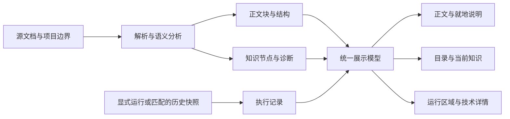

# View 可执行知识阅读体验重设计

| 项目 | 说明 |
|---|---|
| 日期 | 2026-10-24 |
| 状态 | 详细设计建议，待实施；不是已交付能力声明 |
| 审计基线 | `b8a4ddd` / Marqdo 2.1.1；使用当前源码构建的 debug CLI 复核 |
| 输入 | 用户提供的 view 截图：Executable Knowledge 在 Structure 前，Steps、Target、Kind、Signature、Effects、Verification、Lock digest 等字段大量铺开 |
| 范围 | Live view、静态导出、正文结构、知识说明、运行结果、来源与状态呈现；不改语言语义，不增加作者必填的展示 DSL |
| 关联 | [文档原生开发指导](document-native-development-guide.md)、[View 总体设计](view.md)、[文档面与标注](view-document-annotations.md)、[求道相关框架缺口](../roadmap/qdagent-knowledge-support-gaps-2026-10-24.md) |

## 1. 设计决策

**View 首先呈现知识文档本身，结构帮助读者理解和定位，机器信息解释当前所读内容。** 正文、程序结构、知识关系与执行证据应由同一份源文档关联起来，而不是顺序展示几份互相脱节的报告。

确定以下方向：

1. 移除正文之前整块展开的 Executable Knowledge。主阅读流首先出现作者的标题、介绍和内容；不把完整机器报告简单搬到正文后继续平铺。
2. 保留并改进现有 Structure 的叙述保真文档面，面向读者命名为“文档”。正文、表格、公式、函数和可执行步骤在原位置阅读，不生成一份模型改写的平行说明书。
3. 右侧“本文结构”负责章节与知识单元定位；选中知识片段后，在同一辅助栏展示它的解释、输入输出、来源和验证依据。源码标识、摘要与完整协议放在可展开的技术详情中。
4. 运行结果就地关联到对应步骤，明确运行实例与输入；完整日志、运行控制和源码放在正文后。看见一个数值时，读者必须能知道它是文档声明、计算结果还是历史快照。
5. 静态分析、程序运行、测试断言、来源关联和领域确认分别表达。不能用一个 `ok`、`pure` 或绿色“已验证”覆盖不同事实。
6. 功能渐进增强：无 JavaScript、静态导出、移动端、打印时仍能读完文档、定位知识和查看必要依据。普通短文不变成复杂仪表盘。

这些决策恢复 [view.md](view.md) 原有“文档面为主、Browse 与 Debug 分工”的方向，同时修订过度依赖引出线和默认展开技术面板的呈现方式。

## 2. 现状审计：为什么截图难读

### 2.1 可定位的实现依据

| 观察 | 当前代码 | 对阅读的影响 |
|---|---|---|
| 知识面板位于正文前 | [html.rs / page_file](../../src/view/html.rs) 的模板顺序为 notebook → knowledge → Structure → Execution → Source | 必须先越过辅助资料才能看到文档；模块越多越严重 |
| 所有制品一律展开 | [render.rs / render_knowledge_html](../../src/view/render.rs) 按文件筛选 artifacts，并逐项输出完整 `<dl>` | module/type/function 同等突出，容器元信息挤占知识内容 |
| Steps 脱离所属结构 | 同函数把当前文件所有 steps 放在单一 `<ol>` 中，展示 kind、label、完整目标 ID | 静态步骤容易被误读为实际执行顺序；调用/循环/正文引用混在一起 |
| 内部字段未经阅读转译 | URI、签名、effects、verification 拼接文本、完整 sha256 默认可见 | 读者仍不知道这项知识解决什么问题、怎样用、依据在哪里 |
| “Lock digest”名实不符 | 该字段实际显示 `artifact.hashes.artifact`；[mod.rs](../../src/view/mod.rs) 编译使用 `LockMode::Off` | 制品摘要被误读为已经锁定且通过复现检查 |
| 静态说明与运行脱节 | 每张卡固定输出 `Not executed by knowledge preview.`；实际 run capture 在另一条路径 | 即使页面有运行结果，也很难理解“未执行”到底指什么 |
| 分析失败静默消失 | `build_file_view` 对语义编译结果使用 `unwrap_or_default` | 无知识、分析失败、尚未分析在界面上都可能表现为空 |
| 标题与层级表达较弱 | `page_file` 标题取文件名；[document.rs / render_fun_heading](../../src/view/document.rs)统一用 h3 | 作者 frontmatter 标题未用于页标题，嵌套结构主要靠其它线索判断 |
| 知识组件缺少专用布局 | `knowledge-*` 在 HTML 中有类名，但 `html.rs` 没有与面板匹配的专用样式规则 | 大量使用默认列表/定义列表排版，空白多、关系弱，和正文主题缺少一致约束 |
| 新旧皮肤叠加 | `html.rs` 内基础 view CSS 与 `notebook_ui` 大块 notebook 主题共存 | 正文、注释、知识区的字号和密度不一致；不能只修一个卡片颜色 |
| 验收主要看元素存在 | [executable_knowledge.rs](../../tests/executable_knowledge.rs) 的 view 用例检查 step 类名、kind 和 `#stmt-` 链接 | 没检查正文优先、跳转目标存在、可读文案和实际布局 |

已有能力应保留：[document.rs](../../src/view/document.rs) 的叙述/表格保真、Occlusion 描述与实现分离、函数大纲、调用帧/循环帧选择、[annot.rs](../../src/view/annot.rs) 的真实执行标注。重新设计应基于这些能力，而不是退回 AST 卡片浏览器。

### 2.2 对截图的解释边界

截图可直接确认：机器字段先于正文、Steps 只有 `call print`、长 URI/摘要显著占位、英文状态串缺少解释，以及深色底上的孤立黑色短线。

黑色短线的具体来源尚未在浏览器中复现。代码中存在 annotation leader、布局重算和主题覆盖，可能需要检查，但本文件不把它们断言为唯一根因。实施时应使用用户截图对应页面复现，检查实际 DOM、computed style 和几何位置；不能用全局隐藏所有 SVG/边框来掩盖问题。

### 2.3 本轮实际复核

把 [public/features/01-phase-i-treewalk.mq.md](../../public/features/01-phase-i-treewalk.mq.md) 复制到临时目录，使用 debug 2.1.1 执行静态导出并检查生成 HTML：knowledge 确实在 structure 前，共 3 个 `knowledge-card`（含 Steps）和 2 个完整 sha256。该短文的核心只是介绍 tree-walk 流程并打印一句话，当前辅助内容明显过重。

另用隔离临时文件复核 `view output --no-exec`：嵌入的 `fs.write_text` 仍创建了临时标记文件。原因是 [output.rs / write_static](../../src/view/output.rs) 先调用会执行的 `build_file_view`，再在 `opts.no_exec` 分支清空结果。**这是已复现的执行/呈现不一致，必须修复，不能仅把标签改成“未运行”。** §9 给出新的构建边界。未执行线上浏览器像素比对，本文线框为目标设计。

## 3. 读者任务与设计成效

| 读者任务 | 默认应看到 | 按需展开 | 成功判据 |
|---|---|---|---|
| 理解这篇文档 | 作者标题、介绍、正文和核心表格/步骤 | 完整源码 | 不滚过机器报告就能开始阅读 |
| 看懂文档结构 | 章节、类/规则/函数的真实层级，当前位置 | 参数和局部步骤树 | 能判断一个步骤属于哪个知识单元 |
| 理解某项知识 | 描述、简洁公式/调用、条件、返回含义 | payload、契约、精确目标 | 能解释它做什么、需要什么、产生什么 |
| 判断结果是否可信 | 来源状态和所选运行的明确结果 | 测试、来源片段、版本和诊断 | 能区分“可以运行”和“事实成立” |
| 跟踪跨文档复用 | 友好目标名、所属文档、输入输出 | 依赖关系、完整标识 | 能到达定义并返回原阅读位置 |
| 检查某次运行 | 本次输入、选中调用/迭代、对应结果 | 日志、历史帧 | 不把不同运行的值混在一起 |

不要求所有读者理解 SymbolId、IR、hash 或 effect 协议。开发者仍能找到这些信息，但它们不再成为阅读的前置条件。

## 4. 页面信息架构

### 4.1 默认桌面布局

```text
┌ Marqdo   项目 / 文档路径                    搜索   主题 ┐
├───────────┬───────────────────────────────┬────────────┤
│ 文件目录  │ Phase I — tree-walk interpreter│ 本文结构   │
│           │ Lex · parse · check …         │ 介绍       │
│ 当前文件  │ [运行记录：尚未运行] [详情]    │ main 入口  │
│           │                               │            │
│           │ Milestone: Phase I …          │            │
│           │ Pipeline: load → … → eval     │ 选中后：   │
│           │                               │ 当前知识   │
│           │ main · 入口                   │ 作用       │
│           │ 输出说明  print text=… [说明] │ 输入/返回  │
│           │                               │ 来源/条件  │
│           │ ▸ 运行与结果                  │ 检查/运行  │
│           │ ▸ 完整源码                    │ 技术详情 ▸ │
└───────────┴───────────────────────────────┴────────────┘
```

布局是文件导航、主文档、一个辅助栏，不能增加第四条永久侧栏。右栏上部保留可收起的“本文结构”；用户选中片段后，下部显示“当前知识”。空间不足时以当前知识替换下部内容，并提供“返回目录”操作。打开/关闭详情不改变正文宽度，避免重排导致阅读位置跳动。

主文档的默认顺序：

1. 文档标题、已有 description、简短状态入口；title 缺失时退回文件名。
2. 源文档的正文、结构和轻量就地知识说明，保持作者顺序。
3. “运行与结果”：运行按钮、输入、所选运行结果、输出图形/日志；已有重要失败有就地入口。
4. “完整源码”及“文档技术信息”，默认折叠。

不在顶部强制生成内容摘要、全量函数清单、巨大状态矩阵或知识关系图。没有 description 时不调用 LLM 补写。结构大纲始终可达，正文不因折叠辅助栏而变成无结构的文章。

### 4.2 尺寸与响应式规则（设计目标）

| 可用宽度 | 布局 |
|---|---|
| ≥1280 CSS px | 文件栏约 220–260px；正文弹性；辅助栏约 280–320px；正文中文行长约 32–44 字 |
| 900–1279px | 文件栏可收起；正文优先，辅助栏可切换为有标题的侧抽屉 |
| <900px | 单列文档；“目录”“当前知识”作为明确按钮打开抽屉或块内 details |
| 320–390px 手机 | 标题、正文、状态不横向溢出；长表格/代码局部滚动，整页不左右拖动 |
| 打印 | 正文展开，必要来源/验证摘要转为节后附注；交互按钮和导航隐藏；技术原始字段按导出选项包含 |

在 1440×900、100% 缩放的短文验收样例中，首屏应包含至少一段正文和首个主要结构单元；状态头不得因每个 artifact 增长而把正文推出首屏。此约束不截断作者自己的长标题或介绍。

### 4.3 普通文档与复杂知识文档采用同一布局

- 普通说明页只有 main/print：显示原文与输出操作，技术区保留模块信息；不强制展示“1 项可执行知识”卡。
- 可复用函数库：目录列出函数；函数标题下出现紧凑签名和“说明”入口；即使无 main，也能正常阅读。
- 事实/规则文档：来源、条件与验证紧邻相应知识；来源问题不能藏进页尾。
- 教程/Notebook：保留源文档的代码单元与结果；全局单元运行条收进运行区域或显式工作模式，不能把所有文章永久变为 notebook 工具台。
- 大文档：目录按真实层级和顺序组织，可搜索；正文不因知识数量膨胀为另一份报告。

## 5. 文档与结构呈现规范

### 5.1 标题、类与函数层级

页标题优先来自解析后的 frontmatter `title`，其次使用合适的源文档标题，再回退文件名；不要自行用正则重解析 YAML。保留原文标题内容，不擅自把技术名称改成模型生成的名称。

“本文结构”同时服务阅读和程序定位，但明确区分：

- 作者章节按实际文档关系展示。
- 可执行的类/类型、函数、入口附轻量类型词，例如“规则”“函数”“入口”；类型词来自编译结果或已声明元数据，不由标题猜业务类型。
- 同一节点既是章节又是函数时只有一个目录项，旁边标类型，避免两棵树重复。
- 嵌套函数、分支、循环在对应父节点下展开；语义归属与 Markdown 可视层级分别保留，不把所有内容都扁平化为 h3。
- 普通段落引用不提升为函数；module 容器不自动成为一张与业务函数同权的卡。

DOM 标题使用连续、可访问的层级；实际语法的 `#`/`##` 层数在源码面保留。用户复制源码时取得原始合法语法，而非为了 HTML 标题级别改写过的内容。

### 5.2 可执行步骤：就地解释并保留上下文

| 编译器步骤 | 默认阅读文案 | 展开后 |
|---|---|---|
| observe | “读取：商品单价” | 集合、取元表达式、字段说明、当前调用下的值 |
| derive | “计算：商品小计” | 公式、输入来源、计算条件、当前结果 |
| call | 优先作者标签；无标签时“调用 商品小计” | 目标、所属文档、实参映射、返回和运行记录 |
| iterate | “逐项处理：订单商品” | 集合、循环体、迭代数、所选迭代 |
| narrate | 正文保留作者描述，附“知识引用”入口 | 定义与来源；不当作已执行步骤 |
| navigation | 标准文档链接 | 正常导航，不显示虚构的执行结果 |
| 空 payload / stub | 作者描述 + “待实现” | 缺失的实现和已有诊断，不能展示成功数值 |

名称来自当前节点的 label、声明说明、目标可读名，依次回退；没有业务描述时就显示“调用 print”，不得自动声称它是“验证知识”或“输出最终结论”。普通 print 在所属文档位置解释输出作用，放在“输出”类信息中，不作为高价值知识卡突出。

“步骤”列表只在当前知识详情中显示，标为“文档中的步骤”或“结构步骤”。静态序号不能暗示实际执行时序；实际轨迹另按运行事件呈现，分支和循环保留嵌套。

### 5.3 描述、实现与结果的三层关系

以 `**总价 = [计算订单小计](pricing.小计(数量, 单价))**` 为说明示意：

```text
计算订单小计                         [说明]
  总价 = pricing.小计(数量, 单价)     ← 简短实现，次一级视觉
  本次示例：数量 2，单价 30 → 60     ← 仅有匹配运行记录时出现
```

作者的上下文句、返回说明、单位和条件仍在原位。短公式/实现可次级显示，长 payload 默认折叠到详情；显式“展开实现”控制可对当前知识单元生效。不得把所有代码完全藏掉，使“代码即文档”退化成只有自然语言标签。

复制操作区分“复制说明”和“复制源码”；源码来自源 span，保留必要定界符、参数和 import 依赖提示。显示为漂亮文本的结果不能被复制成伪造的可执行代码。

### 5.4 表格、条件与关系

数据表按作者结构呈现，表头固定语义，单位与列说明常显；契约表按输入/返回/约束组织。显示层不能把 Marqdo 列向集合悄悄换成行向记录；需要另一种预览时明确标为预览，并能查看真实形状。

前提条件与失败分支不得因“简洁”隐藏。默认显示全部分支结构，所选运行只突出实际命中的分支，继续遵守 [调用帧与结构保真](view-frame-selection.md)。

跨文档关系默认用可读链接，例如“使用：标准税率 · tax.mq.md”，而非 `mq://…`。直接依赖与被引用者各列前几项并可展开；可选局部关系图放在详情层，不作为默认阅读画布。关系图必须有等价文字列表，并显示未知/动态关系，不能补画不存在的边。

## 6. 当前知识详情：回答问题，而非列出字段

### 6.1 内容顺序

```text
商品小计                          函数
根据数量与单价计算商品金额。       ← 仅引用已有描述

输入       数量：整数；单价：金额  ← 类型/单位未知则明确未知
返回       金额
条件       数量非负                ← 仅当已声明且可定位
实现       数量 × 单价

来源       定价说明 / 第 2 节      [打开]
检查       契约未检查；测试未运行  [查看依据]
运行记录   示例 #2：2 × 30 → 60   [定位输出]
使用       …                      [查看定义]

▸ 技术详情：精确标识、完整签名、效应、摘要、诊断 JSON
```

此处“金额”“数量非负”等只用于解释布局，不宣称当前样例具有这些元数据。没有信息就省略非关键行或写“未声明”，不得推断成“无限制”“没有来源也可靠”。缺失影响可用性时常显；纯工具没有业务来源并不自动是错误。

### 6.2 当前字段的去向

| 当前字段 | 新的主要位置与文案 |
|---|---|
| Target / `mq://…` | 标题处可读定义链接；完整 ID 在技术详情，可复制 |
| Kind / callable | 标题旁简短类型词；module 信息进入文档技术信息 |
| Signature | 输入/返回紧凑表；完整规范签名可展开 |
| Effects | “涉及的操作”，说明文件读写、网络等；未知明确显示，非纯不等于失败 |
| Verification 长串 | 分项检查和证据表，见 §7 |
| Lock digest | 更名“制品摘要”，技术详情内显示；锁状态单独来自真实 lock report |
| Depends on | 可读目标列表，指向定义与引用位置；未分析不能写“无依赖” |
| Execution 固定句 | 匹配运行记录，或“尚无该知识的运行记录” |
| SourceRef / applicability | 当前遗漏的关键内容：放入“来源”和“适用条件” |

默认不铺完整 hash。技术详情可显示缩略摘要并提供全值/复制；缩略值不用于识别唯一性。没有读取锁报告时写“未检查锁定状态”，不能把拥有摘要显示成“已锁定”。

### 6.3 交互、跳转与返回

1. 点击正文的“说明”或目录知识项，选中同一 `node_id`；正文轻量高亮，右栏同步。键盘和触屏具有等价入口，不依赖 hover。
2. 跳转到定义时保留来源文件、锚点、滚动位置和所选运行；返回恢复阅读位置。
3. 文件、符号与语句不能只靠显示名称匹配。同名函数的详情显示所在文档和父结构。
4. 默认不自动抢焦点、不因滚动不停替换用户正在阅读的详情。滚动只更新目录当前位置；点击选择才改变详情。
5. 手机抽屉有标题、关闭、返回焦点和滚动管理；无 JS 时使用正文附近的原生 details 或页尾知识附注锚点。
6. 当前 URI 不在导出范围内时显示“定义未包含在此次导出”，提供可读路径和复制引用；禁止输出必然失效的 `mq://` 或 live `/file` 链接。

## 7. 状态设计：读者必须知道什么被证明了

### 7.1 分离三个状态来源

| 状态来源 | 可以说明 | 不能说明 |
|---|---|---|
| 编译/静态分析 | 结构解析、目标绑定、契约检查结果、已建模效应 | 程序已运行、答案正确、资料真实 |
| 运行记录 | 指定输入、环境、源码版本下的执行与输出 | 覆盖所有输入、测试通过、来源可信 |
| 证据/验证记录 | 哪个断言/测试/来源核验通过，何时失效 | 未执行或未核验的其它部分也可靠 |

顶部仅给紧凑事实，例如“静态分析完成 · 尚无运行记录”，或“有 1 项来源问题 · 查看”。普通 unknown/unchecked 不应制造全页红色警报；与当前结论直接相关的失败、过期、未解析必须就地提示且可定位。

### 7.2 分项文案映射

| 机器状态 | 阅读文案 |
|---|---|
| parse=passed | 文档结构可解析 |
| resolve=passed | 此项检查报告目标已解析；覆盖范围见详情 |
| contract=unchecked | 契约尚未检查 |
| execution=not_run | 尚无执行记录 |
| tests=unknown | 尚无测试记录 |
| evidence=sourced | 已关联来源，内容尚未核验 |
| evidence=unverified | 来源内容尚未核验；结合来源列表判断是否已关联 |
| missing_source / expired | 来源缺失 / 已过适用期 |
| domain=unreviewed | 尚无领域审阅记录 |
| effects=pure | 静态分析未发现已建模的外部操作；展开可看范围 |
| effects=unknown | 涉及的操作尚不能完全确定 |
| 无对应字段 | 未提供该项检查结果 |

分项取值不能自动升级成综合“可信”。只有宿主选定的政策实际给出聚合结论，才显示“满足 ×× 政策”，同时附政策名称、版本与证据；业务条件还须明确展示。

### 7.3 结果来源与失效

每个运行值绑定 `run_id + source_digest + node_id + call_id + loop/iteration` 中适用的字段，展示本次输入或简短上下文。无节点映射时只展示整次运行输出，不硬塞到某个函数旁边。

静态导出有快照时标“导出快照”，附生成时间/输入；读者切换调用帧是在看历史结果，不叫“重新计算”。源码、依赖或来源与记录不匹配时标“历史结果，版本已变化”，不继续用成功样式绑定到新正文。

正文里的字面量可以显示为“文档声明值”；解释器实际执行得到的值才叫“运行结果”。没有值、返回 None、stdout 为空、尚未运行、执行失败必须分开，不能统一成 `(no stdout)`。

### 7.4 空态与错误态

| 情况 | 处理 |
|---|---|
| 没有可识别知识单元 | 正常显示文档，不插空知识面板 |
| 语义分析失败 | 保留可读正文/源码，显示“知识关系暂不可用”及可定位诊断 |
| 局部未解析 | 仅对应片段显示问题，保留其它已知结果 |
| 无运行或 no-exec | 运行区说明原因，使用中性状态，无绿色运行成功标记 |
| 运行失败 | 错误摘要定位到源片段；日志在运行区，静态知识仍可读 |
| 证据过期/冲突 | 相关知识常显问题、来源与影响；不静默选择一个结论 |
| 分析被截断/超过扫描范围 | 显示范围和未覆盖项；“未发现”不能替代“没有” |

## 8. 视觉、密度与可访问性

### 8.1 排版与主题

正文建议 16–18px、行高约 1.65；辅助说明 13–14px、行高约 1.5；代码使用等宽字体，全文不因进入 notebook 主题缩为密集工具面板。主次依赖字号、间距和位置共同表达，不能仅靠颜色。

使用现有系统字体和主题机制，建立统一的 view tokens：正文/辅助文字、背景、细分隔、焦点、成功/警告/错误。知识组件只依赖 tokens，不硬编码黑色线条或白底。支持明暗主题，首次尊重系统/显式设置，不为这次改版再写第三套皮肤。

表格与长公式允许局部滚动；ID、路径在详情中可换行；主文无整页水平滚动。重要来源和适用条件不使用极浅灰隐藏。对比度验收目标：普通文字至少 4.5:1，大字和必要非文本边界至少 3:1；这些是实现验收目标，尚非本轮测量结果。

### 8.2 注释和连线

默认使用紧邻内容的短结果行或有标签的注释块，优先通过“同一节点名 + 明确位置”关联。长 L-leader 不再是默认必需元素；复杂节点可保留短连线，必须满足端点存在、在同一块内、不交叉、不覆盖文字。

当目标折叠、帧过滤、元素隐藏或几何测量失败时，不绘制连线。主题/字体/容器宽度变化后只重算当前可见块；采用可取消的局部布局更新，不全页不断测量。窄屏、打印、reduced-motion 下直接使用有编号的注释。截图中的孤立线条归入专门视觉回归场景。

### 8.3 键盘、屏幕阅读器与退化

- 目录用 nav，正文用 main/article，详情用有名字的 aside/section；标题层级连续。
- 展开按钮有 `aria-expanded/controls`；选中状态、失败和待验证都有文字，不依赖颜色或图标。
- 深链接滚动有 `scroll-margin-top`，聚焦目标不被固定工具条遮住；关闭详情后焦点回到触发点。
- 不使用只有鼠标悬停才能看到的来源、代码或错误。大表格有标题与表头关系，日志可复制。
- 无 JS 时正文、目录锚点、来源链接、原生 details 和静态结果仍工作；只失去实时联动与运行操作。
- 选择帧不隐藏源结构；隐藏实现也不能删除文档含义和必需条件。

## 9. 技术设计与数据契约

### 9.1 从预拼 HTML 改为可关联的展示模型

当前 `FileViewModel.knowledge_html` 是独立 HTML 字符串，难以与正文、trace、诊断同步。建议新增结构化 `KnowledgePresentation`，在 Rust 端形成同一份模型，由正文、目录、详情共同消费。兼容阶段可保留旧字段，但不让它继续成为唯一知识接口。

```text
ViewDocument
  document_id, source_digest, semantic_generation, title, description
  blocks[]                       保真正文结构及 source span
  outline[]                      标题/知识单元父子关系
  knowledge_nodes[]              对应 artifact/ref/step，不复制语义解释器
  diagnostics[]                  范围、严重性、可读说明、定位
  execution_state                明确未运行/运行中/成功/失败/快照
  run_records[]                  与文档版本相匹配的证据

KnowledgeNode
  node_id, artifact_id?, symbol_id?, ref_id?, step_id?
  owner_id?, source_span, display_name, authored_description?
  kind, signature?, payload?, dependencies[], provenance[]
  applicability?, verification[], effects, coverage
  execution_refs[]
```

这些字段为建议契约，未承诺当前 IR 已提供所有信息。语义事实来自 `SemanticProject`，文档叙述来自解析后的源结构，执行事实来自 capture；缺少关系时展示 unknown，不让 UI 用名称模糊匹配或调用模型编造。

### 9.2 数据流



知识模型不通过“render HTML → 再抓取文本”生成。页面分析失败不可用空字符串吞掉，应保留有状态的结果；部分成功与整体失败分开。

### 9.3 源位置、稳定身份与锚点

目前 step 跳转用 `#stmt-{line}`，函数用 `#fn-{line}`。一行多个表达式、正文段落合并、同名函数、源码插行都会使单纯行号不够。

新增内部节点锚点注册表，将文档块、函数、语义 step/ref 与真实 DOM id 映射；使用 artifact/node 身份和源 span 生成页内唯一 ID，不把未经编码的 URI 当 DOM id。当前编译器没有稳定 SyntaxNodeId 的地方，退化为“源码版本 + span”，明确跨版本不可保证稳定；不能只把行号哈希一下就宣称稳定身份。

兼容现有 `#structure`、`#fn-N`、`#stmt-N` 链接，保留别名或定位映射；所有生成链接都验目标存在。跨文件 href 复用 [html.rs 的 LinkMode/href_file](../../src/view/html.rs)，静态导出保持相对路径；路径展示解码与 URL 安全编码分离。

### 9.4 分离分析与执行，修正 no-exec

将当前 `build_file_view` 拆成可组合路径（名称为建议）：

1. `analyze_document`：读取、解析、语义检查、生成静态展示数据，不执行目标程序。
2. `capture_execution`：只有执行策略明确允许时调用 run/cell runtime，返回真实状态与源版本。
3. `assemble_view`：关联正文、语义和匹配的结果，生成同一个展示模型。

`--no-exec` 必须在第 2 步之前分支，不能先跑后清空；snapshot 模式使用匹配快照，不为了构造 UI 又运行一次。Live 现有自动执行兼容行为在首轮不静默改变，必须通过显式 execution policy 传入并如实标注；若后续将 live 默认改为阅读时不执行，作为独立 CLI 行为变更发布和迁移。点击详情、查看来源、展开关系等阅读操作绝不能触发执行。

知识详情不要求通过运行得出静态信息。实现参数预览/试跑时，使用既有受控执行路径，不因“pure”字样绕过宿主能力边界。本文不新增一套求值器或权限系统。

### 9.5 Live 更新一致性

当前 SSE 会替换 structure_html/bindings_html/trace_json，而知识面板来自另一次静态编译，容易新旧混用。建议更新包包含文档摘要、语义代、run_id 和变更节点；前端仅合并兼容版本的数据。

运行写回导致源码变化时，重新分析后一次更新相互关联的正文、目录、知识与运行映射。原选中节点仍存在则保留选择/焦点/滚动；已消失则明确提示，不能悄悄指向同名节点。旧请求返回晚于新请求时按版本丢弃，不覆盖较新阅读状态。

### 9.6 性能与导出体积

避免每个页面重复编译整个项目。一次静态导出共享同一项目语义结果，逐页投影；live 按项目源指纹、编译器版本、配置和适用性时钟缓存，读取使用一致的语义代。来源/有效期变化必须使相关状态失效，不能无限缓存 sourced。

正文服务端生成，不等待 JS 初始化或全部知识图完成才出现。默认只嵌入当前文档必要知识，深层依赖按需取；静态导出则包含保证离线可用的局部数据与明确范围。大量结果采用折叠/分页，但不能让屏幕阅读器和查找失去正文。

性能验收目标：100 个知识单元的本地选择/展开交互 p95 ≤100ms；1000 单元目录可搜索而不阻塞正文滚动；导出项目的语义编译次数不随页面数线性重复。记录硬件、样例和体积，目标未达时先优化数据重复和布局测量，不以截断关键来源达标。

## 10. 实施文件与兼容策略

| 位置 | 建议变更 |
|---|---|
| [src/view/render.rs](../../src/view/render.rs) | 提取知识展示模型；替换全量 dl 面板；关联步骤归属、友好名称与诊断 |
| [src/view/document.rs](../../src/view/document.rs) | 源块/知识节点映射、正文就地入口、层级标题、可复制原始 span |
| [src/view/html.rs](../../src/view/html.rs) | 正文优先布局、辅助栏、详情/目录交互、状态组件、统一 tokens；保留 LinkMode |
| [src/view/mod.rs](../../src/view/mod.rs) | 分离分析/执行、保留诊断、组装统一模型、项目分析缓存 |
| [src/view/output.rs](../../src/view/output.rs) | 提前应用 no-exec/snapshot 策略、共享项目分析、静态详情与相对跳转 |
| [src/view/annot.rs](../../src/view/annot.rs) | 运行标注与节点/帧/版本关联，减少重复输出；缺映射不伪绑定 |
| [src/view/debug_page.rs](../../src/view/debug_page.rs) | 仅回归检查共享组件；不把阅读布局强加给 debug |
| [tests/executable_knowledge.rs](../../tests/executable_knowledge.rs)、view 单测 | 从字符串存在升级到顺序、锚点、状态和执行边界断言 |
| 文档与 public 示例 | 更新旧 View 布局说明、截图和行为描述，区分历史默认与新设计 |

默认展示不要求作者补特殊 frontmatter；title/description、函数说明、契约和来源已有时直接受益。尚无信息的旧文档保真显示，并在详情中如实缺省。

与现有文档的关系：保留 [view-document-annotations](view-document-annotations.md) 的叙述主导和真实结果，修订“长 L-leader 为默认”；保留 [view-frame-selection](view-frame-selection.md) 的源码常显与帧隔离；[view-markup-surface](view-markup-surface.md) 的历史 Classic 例子需按当前默认语法同步，不能在新 UI 继续教授旧取元。外联/WASM 交互沿既有独立路线发展，不作为完成本次阅读改版的前置。

## 11. 分阶段交付

### V0：先纠正顺序、误导状态和执行边界

正文提前；完整知识报告收进明确的辅助入口，module/type 容器默认不铺卡；“Lock digest”改为准确的摘要标签；状态不再共用一个 ok。修复 no-exec 先执行问题，分析错误可见。暂不等待完整节点模型，就能显著改善截图场景。

V0 不算最终完成：仅把面板搬到后面/折叠，仍未解决正文与知识的关联。

### V1：完成阅读与结构理解的主闭环

统一展示模型、标题/目录层级、就地说明、当前知识详情、友好定义跳转与返回。完成函数、计算、来源、空态与基本运行结果的正负例；live/static 共用。

### V2：贯通运行、来源和跨文档关系

匹配运行实例与版本、调用/循环帧、来源定位/失效、局部依赖关系、SSE 原子更新。上游证据能力尚不完整的地方明确显示未知，不能以 UI 补出“验证通过”。

### V3：移动端、离线和规模验收

完成键盘/读屏、无 JS、打印、暗色/浅色、100/1000 单元性能、视觉回归与读者测试。发布前同步 public 示例与说明，保留旧锚点兼容。

## 12. 验收矩阵

### 12.1 必测文档

| 样例 | 必须验证 |
|---|---|
| 截图对应 Phase I 页 | 正文先出现；无 full URI/hash 瀑布；print 在所属正文解释；无孤立线条 |
| 纯叙述/少量 Markdown 页 | 阅读无知识空卡、无误导运行徽章 |
| 单个纯函数，无 main | 参数/返回与调用方式清楚，不因无入口标全文失败 |
| 订单定价、多文档 import | 小计/税率/总额归属和依赖可追踪；输入和结果可对应 |
| 带来源的事实与过期/缺失来源 | sourced 不显示已证实；问题在对应知识旁可见 |
| 同名函数、多次调用和循环分支 | 定义唯一；切换帧只改结果和高亮，不隐藏结构 |
| 空 payload、动态调用、未解析引用 | 待实现/动态/未解析准确可辨，不能展示虚构结果 |
| 一行多个链接、嵌套表达式、中英文/长路径 | span 对应、锚点唯一、文本不丢失、不水平溢出 |
| 运行失败、分析失败、快照过期 | 三种情况分开，仍能读到正文与具体诊断 |
| 外联单元、变量大表、长日志 | 单层主体与对应结果，不重复三份输出；局部滚动 |

### 12.2 自动化判据

1. DOM 中文档主体先于全量知识技术详情，标题来自既有元数据；短文没有隐藏正文的默认展开报告。
2. 每个知识/目录链接都能定位真实节点；一行多节点和同名跨模块不冲突；live/static 路径均有效。
3. 验证、运行、来源状态按固定真值表渲染；无证据时绝不输出综合已验证。
4. no-exec 用隔离目录的副作用计数测试证明没有执行；snapshot 不重跑；展开详情也不执行。
5. 帧选择和 SSE 更新保留正文结构、选中身份与焦点，拒绝过期结果包。
6. 明暗主题/320、390、1024、1440 宽度/200% 缩放下无遮挡、截断关键条件和整页横向溢出；孤立 leader 数为零。
7. 无 JS、file 静态打开、打印预览都保留正文、定义/来源导航和必要证据说明。
8. 输出中的作者内容、label、URI/属性与嵌入 JSON 按原上下文转义；资料中的 HTML/脚本不能因为新详情组件被直接执行。

字符串断言只能覆盖结构，不能替代浏览器布局验收；需截图基线和真实键盘交互测试。可复用现有测试基础，避免测试只镜像组件实现。

### 12.3 读者任务测试

建议用至少 5 位未参与实现的读者，分别完成三个任务，并与当前页面对照：

- 在 30 秒内说清文档目的并找到主要规则/函数。
- 在 60 秒内找到某个结果的输入、定义和原始来源。
- 正确区分“来源已关联但未核验”“本次运行成功”“未运行/历史结果”，不得误认为都已验证。

目标为至少 4/5 完成前两项，第三项无误导性判断；小样本仅作为可用性门槛，不声称统计显著。记录失败位置并修正信息架构，不能只问“是否好看”。

## 13. 完成定义与本次交付边界

完成的 view 应让读者先读懂文档，再自然看到其中的知识与执行结构；需要深入时能沿着一个具体片段追到实现、输入、结果和证据。全量技术字段仍可查，但不要求读者先理解编译器才能读文档。

本次只提交设计文档与索引，不修改渲染实现。实证包括用户截图、当前模板/渲染路径、静态 HTML 顺序检查和临时 no-exec 反例；布局尺寸、交互、性能和读者任务结果均为待实施的验收目标。
