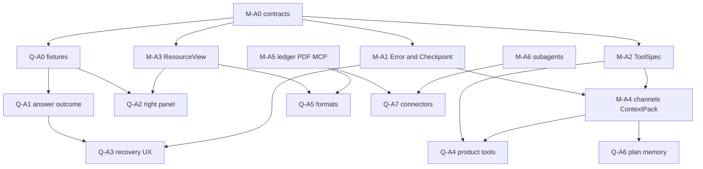

# 跨仓 Agent 可靠性开发计划（2026-10-27）

| 项目 | 约定 |
|---|---|
| 状态 | **Proposed / planning**；本文是排期与验收编排，**不是**已实现声明 |
| 日期 | 2026-10-27（Asia/Shanghai） |
| 基线 | Marqdo `6ffe5ce` / 2.1.4；qdagent `c4c976c`（设计文档基线曾为 `16f26d7` / `68b757e`；排期以当前 HEAD 为准） |
| 协议真源 | [智能体能力补足设计](../design/agent-reliability-tools-resources-2026-10-27.md) |
| 产品真源 | [qdagent 智能体能力与预览](../../../qdagent/doc/design/agent-capabilities-and-preview-2026-10-27.md)（同级 checkout） |
| 证据 | [官方调研与 F01–F20](../research/agent-capabilities-2026-10-27.md) |
| 产品侧镜像 | [qdagent 开发计划镜像](../../../qdagent/doc/roadmap/agent-capabilities-development-2026-10-27.md) |

本文只编排依赖、落点、门禁与发布次序。**不发明第二套 Agent Framework**；不修改 `doc/next/`；不把 capability bit 在合同实测前标真。协议字段以设计文档为准，路线图只引用不另造 schema。

## 1. 目标与架构边界

让同一套文档原生 Agent 在模型错误、工具失败、网络中断后有界恢复；工具可发现、可验证、可审计；结果同时服务模型上下文与用户阅读。保留 `.mq.md` 工作簿、EKC 与验证证据的权威地位。

| 议题 | Marqdo 所有 | qdagent 所有 |
|---|---|---|
| 恢复 | ErrorV1、预算、CheckpointV2、效应账本、运行/事件语义 | 恢复按钮、会话关联、凭证修复入口、产品政策 |
| 工具 | ToolSpec/Call/Result、schema、权限执行、并发、MCP 传输 | 业务工具、默认集合、连接配置、用户授权范围 |
| 回答 | AgentOutput 分通道、输出预算、ContextPackV2 | 简洁/标准/详细策略、摘要与产物卡、ASK/BUILD |
| 资源 | ResourceRef/View、只读预览、转换插件接口 | 笔记/文件/产物 ID 映射、owner 权限、预览布局 |
| 知识 | preflight/reuse/verify/compile、记忆原语 | 何时提议沉淀、用户画像与可见管理 |
| 调试 | span、结构化事件、用量与错误码 | 可读过程、运行详情、产品评测语料 |

## 2. 现状（不再重做）

| 已落地基础 | 说明 |
|---|---|
| Agent A0–A4、O1–O5 | 文档原生 step/plan/run、沙盒与优化波次；扩展 `ext/ai/agent`，不另造循环 |
| 隔离 Web 运行时（ADR 0009） | `src/runtime/` Verified；本轮补 Agent 步骤语义，不重建进程池 |
| Workbench 合同切片 | DocumentView / Locator / capabilities；Partial，随本轮补 F 矩阵 |
| 可执行知识 S0–S6 | 本地确定性子集已门禁；**不重开 S0–S6** |

本轮增量（设计已锁、代码待做）：`AgentErrorV1`、`CheckpointV2` + effect ledger、`ToolSpecV1` 统一调度、`ResourceViewV1`、`AgentOutputV1` 通道、`ContextPackV2`。

**产品措辞约束**：本地门禁绿 ≠ 远程/多租户安全；≠「知识验证 + Agent 复用闭环」全产品完成。

## 3. 跨仓依赖与日历顺序

### 3.1 强制顺序原则

1. 先 **M-A0 ∥ Q-A0** 冻结跨仓字段与缺陷 fixtures。
2. 立刻 **Q-A1 + Q-A2 + M-A3（文本/md/mq）**——**不得**被完整 CheckpointV2 阻塞。
3. **M-A1** 可先上只读重试 + 原子 checkpoint；**Q-A3** 终态快照可先行，写恢复等 effect ledger。
4. 再 **M-A2 ∥ Q-A4** → **M-A4 / Q-A6** → **M-A5 / Q-A5** → **M-A6 / Q-A7**。
5. 四类恢复必须分开：事件续订 / 步骤重试 / 工作流 resume（新 attempt + `resumed_from`）/ 答案再生成。

## 4. 阶段包明细

### Wave 0 — 合同

| 包 | 修改/新增建议 | 交付内容 | 退出门槛 |
|---|---|---|---|
| **M-A0** | `src/workbench/capabilities.rs`、`tests/workbench_contracts.rs`、新增合同 fixtures | Error/Tool/Resource/Output/Context 协议、旧适配、状态映射；capability **默认 false** | 跨仓字段冻结；未知字段/版本可降级 |
| **Q-A0** | 缺陷样例、HTTP 路由清单、answer/resource fixtures；设计入口 | 固化 F01–F20 相关 fixtures；`mock`/`live` 证据区分 | 与 M-A0 字段一致；不把 mock 当 live |

### Wave 1 — 可见痛点

| 包 | 修改/新增建议 | 交付内容 | 退出门槛 |
|---|---|---|---|
| **Q-A1** | `agent/qdagent.mq.md`、`gateway/openai`、api 映射 | accepted candidate；`outcome` ≠ HTTP `ok`；摘要投影；ASK 不强制六节 | 修复后只展示 B；未通过不标成功（F01/F02/F03） |
| **M-A3（首批）** | `src/workbench/document_view.rs`、新 `resource_view`、媒体适配 | ResourceRef/View；md/txt/code/mq 静态阅读；no-exec | 资源定位与安全语料通过（F15） |
| **Q-A2** | `DesktopFrame`、panel store、`DocumentReader`、ResourcePanel/Preview | 统一右栏；笔记/文件点击不导航；同 renderer | 所有入口同预览（F09–F14） |

### Wave 2 — 恢复

| 包 | 修改/新增建议 | 交付内容 | 退出门槛 |
|---|---|---|---|
| **M-A1** | `ext/ai/agent.mq.md`、`plugins/agent/src/resume.rs`、recovery/effects 模块 | ErrorV1、有界修复、accepted candidate 绑定、CheckpointV2 原子写 | 故障注入不重复写；旧记录不冒险自动恢复（F06） |
| **Q-A3** | `execution/turns`、session store、`api.ts` | 终态快照补齐、恢复动作、错误卡 | 事件恢复 0 工具调用；写恢复须 ledger（F08） |

### Wave 3 — 工具与通道

| 包 | 修改/新增建议 | 交付内容 | 退出门槛 |
|---|---|---|---|
| **M-A2** | `plugins/agent/src/lib.rs`、`mcp_client.rs`、tool registry/dispatcher | ToolSpec/Call/Result；CALL+native 单通道；分页与结果资源 | 未授权调用为 0；失败结果结构正确（F04/F05/F18） |
| **M-A4** | `ext/ai/agent.mq.md`、`plugins/llm`、`src/workbench/run_context.rs` | AgentOutput 通道、预算、ContextPackV2 | 原生与纯文本 provider fixture 可用（F01/F19） |
| **Q-A4** | `agent/tools/`、工具目录、ContextAttachment | 业务工具；保留旧五工程工具别名 | 找→读→改→验证→预览真实闭环 |
| **Q-A6** | 计划折叠、预算 UI、profile 忘记、候选沉淀 | ResponsePolicy UX、记忆边界 | 压缩与恢复不丢用户约束 |

### Wave 4 — 持久与格式

| 包 | 修改/新增建议 | 交付内容 | 退出门槛 |
|---|---|---|---|
| **M-A5** | `src/runtime/` 存储/事件适配、MCP 与转换插件 | ledger↔runtime 对账、PDF/Office 插件、远程 MCP | crash/restart 通过；诚实探测（F16–F18） |
| **Q-A5** | JSON/CSV/图片/PDF UI、网页来源与页/行引用 | 格式扩展与转换进度 | 缺插件可读降级；PDF 不假称 OCR |
| **M-A6 / Q-A7** | plan/subtask/sandbox；MCP 配置与委派 | 程序化工具、有界委派、可选浏览器 | **后置**；须证明收益与预算/效应可控 |

## 5. F01–F20 → 包映射

| ID | 摘要 | Marqdo | qdagent | 主要验收 |
|---|---|---|---|---|
| F01 | ASK/BUILD 强制六节 | M-A4 输出通道 | Q-A1 ResponsePolicy | QA-01、MA-T12 |
| F02 | 修复后仍返回 raw | M-A1 accepted 绑定 | Q-A1 | QA-03、MA-T12 |
| F03 | `gated_error` 仍 `status=ok` | M-A0/M-A1 ErrorV1 | Q-A1 envelope | QA-04 |
| F04 | 默认仅五工程工具 | M-A2 registry | Q-A4 目录 | QA-17 |
| F05 | 已有 step/plan/run | **扩展** agent.mq.md | — | 不另造 loop |
| F06 | `resume_save` 裸 `fs::write` | M-A1 CheckpointV2 | Q-A3 UX | MA-T03/T04 |
| F07 | runtime 已有 | 复用，不重建 | 接线恢复 API | — |
| F08 | `resumeTurn` 终态直返 | 事件 vs 再执行分离 | Q-A3 快照补齐 | QA-13、MA-T05 |
| F09–F12 | 右栏/笔记预览缺陷 | M-A3 ResourceView | Q-A2 | QA-06–QA-09 |
| F13 | DocumentReader 非通用分派 | DocumentView 保留 mq；ResourceView 其它 | 预览分派 | QA-09 |
| F14 | 正则 HTML 清洗 | 生产侧 allowlist | DOMPurify + CSP | QA-11、MA-T11 |
| F15 | DocumentView no-exec | 保持；ResourceView 禁 run/verify | — | MA-T10 |
| F16 | pdf/docx/ocr unavailable | M-A5 插件 + 诚实探测 | Q-A5 | QA-10 |
| F17 | legacy web_search 临时文件 | 优先框架 net 工具 | 迁移工具 | QA-17、F20 |
| F18 | MCP stdio 已有 | M-A2/5 timeout/cancel/remote | 连接器配置 | MA-T07 |
| F19 | 历史字符串 standing | M-A4 ContextPackV2 | compose_messages | QA-19、MA-T13 |
| F20 | 弱临时名；workspace `.` | 安全临时文件 + ResourceRef | 资源解析 | QA-08、MA-T11 |

## 6. 验收与发布

### 6.1 Marqdo 门禁（MA-T01–T14）

以设计文档 §10 为准；基础机制用确定性 fake provider/tool；真实 provider 少量单独 smoke 并记费用。摘要：

| 编号 | 必须观察到 |
|---|---|
| MA-T01 | 429 后成功：退避、计量、单一 accepted answer |
| MA-T02 | schema 连续错：一次修复后停；无效参数不执行工具 |
| MA-T03 | 写成功但 receipt 前提杀：unknown_effect→对账；写计数不增 |
| MA-T04 | checkpoint 写一半杀进程：完整上一检查点或明确 corrupt |
| MA-T05 | 终态事件丢失：快照恢复完整消息；工具次数不增 |
| MA-T06 | 重复/并发恢复：同一幂等键一个 attempt |
| MA-T07 | 取消 vs 重试：取消后无新工具调用 |
| MA-T08 | 权限/版本变更：stale/conflict/forbidden |
| MA-T09 | 伪造 CALL/system：不越白名单 |
| MA-T10 | `.mq.md` 预览含写/联网：哨兵不变；只读或安全降级 |
| MA-T11 | 格式/超长/路径逃逸：正确 renderer；越界拒绝；无注入 |
| MA-T12 | 修复 A→B：answer/artifact/verification 均绑定 B digest |
| MA-T13 | 上下文压缩后：约束、待决效应、版本、预算不丢 |
| MA-T14 | 旧 CALL/DocumentView：基础可用；缺失能力明确返回 |

先跑受影响的 Rust/Go/Marqdo 合同与隔离 runtime 金样例，再做跨仓 HTTP/browser gate。性能目标（须记录机器/并发/冷暖缓存）：已缓存 100 KiB 文本视图服务端 p95 &lt; 300 ms；核心工具发现 p95 &lt; 100 ms。

### 6.2 qdagent 门禁（QA-01–QA-20）

以产品设计 §13 为准；路径必须 `serve → api → 权威业务函数 →` 真实前端。零容忍：重复写效应、预览执行副作用、跨 workspace 越权。

实现时：`python3 scripts/check-contracts.py`、相关 workbench 测试、前端 `npm test` / `npm run build`，再跑 Playwright；无服务时 E2E 须明确 skip/失败原因。

### 6.3 Feature flags 与灰度

建议开关：`agent_output_v2`、`resource_panel_v2`、`agent_tools_v1`、`agent_recovery_v2`。启用取决于 runtime capability + 服务端政策，不由前端单独决定。

灰度：内部单 workspace → 多 workspace → 真 provider/断网 → 默认开启。关闭恢复时必须停止接纳新恢复请求并保留 attempt 状态，**禁止**切回会盲重做写操作的旧路径。

兼容迁移：新增协议 → 双读 → 新写 → 验证 → 逐步移除旧适配。旧 resume JSON 可读但不能自动升级成带副作用保证的检查点。

## 7. 伴生轨（登记，不阻塞主线）

| 轨 | 动作 |
|---|---|
| 可执行知识 S0–S6 | **不重开**；消费 BoundCall/EKC；话术保持「本地子集」 |
| 知识支撑 F0（M02/M03/M05） | **并行伴生**：provenance/closure invalidate、真 verify API、Skill 无冲突 |
| Workbench Partial | 随 M-A0/M-A3 补 F 矩阵与 adapters；不重写 M00–M05 |
| 语言 next-phase P3 / Wave B1 评测 | **延后** |
| Web Document/Endpoint | 遵守 ADR 0007；禁止 compose_/json bag 回退 |

## 8. 下一步开工（第一刀实现切片）

确认本路线图入库后，**另开实现回合**（本文件仅文档）：

1. **M-A0 + Q-A0**：合同与 fixtures  
2. **Q-A1**：raw→accepted、outcome 一致性  
3. **Q-A3 子集**：终态快照补齐  
4. **Q-A2 + M-A3 子集**：右栏真实预览（笔记 / md / mq / txt / code）

发布判据是 MA-T* / QA-* 与真实 HTTP/browser 证据，不是接口返回 200 或代码中出现某符号名。
